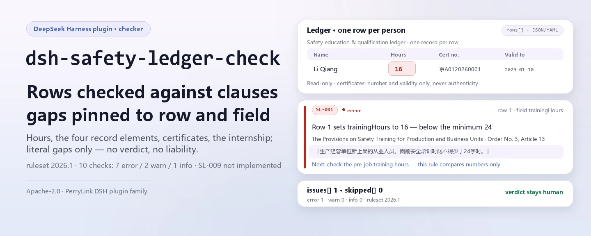

<div align="center">

<picture>
  <source media="(prefers-color-scheme: dark)" srcset="docs/assets/dsh-safety-ledger-check-hero-en-dark.webp">
  
</picture>

# dsh-safety-ledger-check

**Check a construction safety-qualification ledger line by line against the clauses and get the list of which row, what is missing, and which clause requires it — the verdict stays with the reviewer.**

A ledger checker plugin for DeepSeek Harness: one flat ledger (one row per person per event) runs against a versioned rule pack that checks pre-job training hours, the four elements of a training record, special-operation certificates and their validity, and the six-month internship — listing only differences it can point to inside the material, with no compliance verdict and no liability finding.

[Install](#three-step-setup) · [Configuration](#configuration) · [FAQ](#faq) · [简体中文](README.md) · [English](README.en.md)

[](LICENSE)
[](#compatibility)
[](https://www.npmjs.com/package/dsh-safety-ledger-check)
[](https://github.com/PerryLink/dsh-safety-ledger-check/actions/workflows/ci.yml)
[](#compatibility)

[](https://github.com/PerryLink/dsh-safety-ledger-check/stargazers)
[](https://www.npmjs.com/package/dsh-safety-ledger-check)
[](https://dshfind.com/plugins/PerryLink/dsh-safety-ledger-check?ref=badge)
[](https://securityscorecards.dev/viewer/?uri=github.com/PerryLink/dsh-safety-ledger-check)

```sh
dsh plugin --profile <name> add dsh-safety-ledger-check
```

</div>

<sub>Community plugin, not affiliated with DeepSeek. Canonical repository: <https://github.com/PerryLink/dsh-safety-ledger-check>.</sub>

## What it is

`dsh-safety-ledger-check` registers the `safety_ledger_check` tool: hand it a ledger (JSON or YAML), and it runs the bundled rule pack line by line, returning a Markdown difference list plus a structured result. Every finding carries a rule id, row number, field, clause basis, and a "check this" action; every check that could not run is listed in `skipped` with its reason.

It checks the **ledger**, not the site: it answers only what the material itself can prove cell by cell, does not judge whether training outside the ledger happened, and assigns no liability.

- **Who it is for**: construction safety officers, document controllers, and supervisors; no command line required.
- **What you give it**: one safety-education and qualification ledger (JSON / YAML; one row per training record or certificate per person).
- **What you get back**: a difference list graded `error` / `warn` / `info` + the `skipped` checks + a fixed disclaimer.

It answers these questions:

- Do new workers reach the 24-hour pre-job training floor, and managers the 32-hour one?
- Does each training record carry time, content, attendee, and assessment result?
- Do special-operation workers have a certificate number recorded? Is the certificate still valid on the date the person worked?
- Did a first-time certificate holder wait out the six-month internship before working alone?

**Boundary:** it checks the ledger, not the site. It does not verify that a certificate is genuine — that needs the national quality-and-safety supervision platform — and it does not decide whether a trade falls inside the special-operation catalogue, which is published separately under Order 60, Article 2. A blank cell is reported as "the ledger does not record it", never as "it did not happen".

<picture>
  <source media="(prefers-color-scheme: dark)" srcset="docs/assets/dsh-safety-ledger-check-flow-v5-dark.svg">
  
</picture>

## Three-step setup

1. **Install** (pick one channel):

   ```sh
   # git channel (latest main; equivalent to git+https://github.com/PerryLink/dsh-safety-ledger-check.git)
   dsh plugin --profile <name> add github:PerryLink/dsh-safety-ledger-check
   # npm channel (published releases)
   dsh plugin --profile <name> add dsh-safety-ledger-check
   # tarball channel: pnpm pack in this repo, then
   dsh plugin --profile <name> add ./dsh-safety-ledger-check-<version>.tgz
   ```

   `main` resolves to `lib/index.mjs`; the repository does not commit build output, so run `pnpm install && pnpm run build` after installing or before a local sample run.

2. **Minimal config** (sane defaults; a bundle row without `config` uses every default, with the rule pack pointing at the bundled `rules/safety-ledger-check.yaml`):

   ```yaml
   - insert:
       - id: dsh-safety-ledger-check
         name: dsh-safety-ledger-check
   ```

3. **Verify it mounts**: check the profile row, then run the bundled sample:

   ```sh
   dsh --profile <name> --dump-config | grep 'dsh-safety-ledger-check'
   pnpm install && pnpm run build
   node samples/quickstart/run.mjs
   # safety_ledger_check: 1 issue(s) — error 1, warn 0, info 0
   # skipped: 0
   ```

   The sample input is `samples/quickstart/input/SL-001-unsafe.yaml` (16 pre-job hours, below 24); the expected output is `samples/quickstart/expected/result.json`.

**Uninstall**: `dsh plugin --profile <name> remove dsh-safety-ledger-check` (or remove the row from the profile patch).

## Core capabilities

`dsh-safety-ledger-check` keeps rules and code apart: the rule pack is data, and replacing `rules/*.yaml` switches the whole rule set without touching a line of TypeScript.

- **10 rules in one data pack** — `rules/safety-ledger-check.yaml` (version `2026.1`, as of `2026-10-24`) covers training hours, the four record elements, certificate numbers, validity, the six-month internship, and template placeholders; `dateGap` expresses "valid through the work date" as expiry minus work date of at least one day.
- **Checks field consistency, not facts** — numbers only compare magnitude, dates only compare order, fields only check presence; it does not judge whether training content covers the syllabus, nor whether a certificate is genuine.
- **One rule is deliberately left out** — Order 60, Article 20 requires work "as certified", so any mismatch between `certTrade` and `workTrade` is treated as working without a certificate. The engine has no exact text-equality kind; the nearest, `sharedTerms`, compares bigrams and would score "tower-crane operator" and "tower-crane signaler" as the same trade. On a rule carrying a fine up to ¥100,000, that false negative is worse than not checking, so SL-009 is listed under `notImplemented` with the reason.
- **Checks that cannot run say so** — a missing column, a rule disabled by `disabledRules`, or a rule excluded by `onlyRules` all land in `skipped` with a reason; an empty result is not "no problem".
- **Severity follows the evidence** — `direct` can reach `error`; `derived-from-principle` is capped at `warn` (SL-005); `institutional-configuration` at `info` (SL-011); a test asserts it.
- **Read-only, no network, no model call** — pure ESM: it reads the material you pass and computes in memory; tool parameters are `file` / `material` / `rulesFile` / `only`.

### Example

The expected output of the bundled sample (`samples/quickstart/expected/result.json`):

```json
{
  "tool": "safety_ledger_check",
  "issueCount": 1,
  "summary": { "error": 1, "warn": 0, "info": 0 },
  "skippedCount": 0
}
```

*Observed from `samples/quickstart/expected/result.json`; reproduce with `node samples/quickstart/run.mjs`*

How one finding is rendered (`src/view.ts`; the report text itself is Chinese today):

```text
- `SL-001` [第1行 · 字段 trainingHours] 第 1 行「trainingHours」为 16，小于配置下限 24
  - 依据：「trainingHours」应不小于 24
  - 条款：《生产经营单位安全培训规定》（国家安全生产监督管理总局令第3号） 第十三条：「生产经营单位新上岗的从业人员，岗前安全培训时间不得少于24学时。」
  - 建议核对：核对岗前培训学时；本条只比较数值，不判断培训内容是否覆盖大纲
```

*Observed from `src/view.ts:42-45`, `src/shared/rows.ts:574-580`, `rules/safety-ledger-check.yaml:49-64`*

## Standards it follows

Quotations are verbatim from the Chinese government portal (retrieved 2026-10-24):

- The Provisions on Safety Training for Production and Business Units (State Administration of Work Safety Order No. 3), Articles 9 (32/12 hours), 12 (three-level induction), 13 (24 hours), and 22 (the four record elements).
- The Provisions on the Administration of Special-Operation Personnel in Building Construction (Ministry of Housing and Urban-Rural Development Order No. 60), Articles 3, 14 (3-year validity), 20 (work as certified), and 22 (six-month internship).
- The institution's own archive policy (institutional configuration): the template-placeholder requirement in SL-011 is not a statutory clause.

The quotations themselves are verbatim Chinese text, kept that way in the rule pack and in `rules/evidence/clauses.md`.

**Currency:** Order 60 was published 2025-12-17 and **takes effect 2026-06-01**; Article 45 expressly repeals Jianzhi [2008] No. 75. Any rule quoting Order 75 is stale, and this pack quotes none; checking a ledger from before 2026-06-01 calls for the older rule pack.

One rule is **deliberately capped at `warn`**: Order No. 3, Article 12 says "production units such as processing and manufacturing" and does not name construction enterprises. Three-level induction on a building site comes from industry rules and local detail, so the pack quotes the article as it stands and marks it `derived-from-principle` rather than inventing a construction-specific citation.

## Configuration

Schemastery `Config` fields in `src/config.ts` (changeable from cordis.yml). An id-targeted override replaces the whole row — restate every key you need.

| Key | Type | Default | Meaning |
|---|---|---|---|
| `rulesFile` | string | `rules/safety-ledger-check.yaml` | Rule-pack path relative to the plugin package root; an absolute path also works. Replacing it switches the rule-set version |
| `disabledRules` | string[] | `[]` | Rule ids to disable; each disabled rule appears in the report's `skipped` |
| `onlyRules` | string[] | `[]` | Run only these rule ids; empty means every rule |
| `skipNotes` | string | `''` | Note appended to every `skipped` reason, e.g. to cite a local implementation rule |
| `timeoutMs` | number | `120000` | Cooperative tool timeout budget in milliseconds |

Example override in your profile patch:

```yaml
- insert:
    - id: dsh-safety-ledger-check
      name: dsh-safety-ledger-check
      config:
        disabledRules: [SL-011]
        skipNotes: run under the institution's 2026 archive policy
        timeoutMs: 180000
```

A tool call can also pass `file` or `material` (exactly one), override the rule pack for one run with `rulesFile`, and narrow the rules with `only`; those arguments are not written into the profile.

## Material format

One flat ledger: one row per person per training record or certificate. JSON or YAML, with a top-level `rows` key (also accepted: `items` / `records`, and the Chinese row keys documented in `src/model.ts`); the header may carry `project` / `unit` / `period` / `checkedAt` / `basis`.

| Canonical column | Meaning |
|---|---|
| `personName` | Person |
| `trade` | Trade |
| `educationLevel` | Three-level induction stage (company / project / team) |
| `trainingHours` / `managerHours` | Pre-job hours / manager and safety-officer hours |
| `trainingDate` / `trainingContent` / `assessResult` | Three of the four training-record elements (the attendee is the row itself) |
| `certNo` | Special-operation certificate number |
| `certTrade` / `workTrade` | Trade on the certificate / trade actually worked |
| `certIssueDate` / `certExpiryDate` | Validity window |
| `workDate` / `soloWorkDate` | Work date, and first solo work date |
| `remark` | Remark |

A real ledger uses the Chinese header aliases, matched through the same canonical fields:

```yaml
target: 安全教育与资格台账
rows:
  - 姓名: 李强
    工种: 塔式起重机司机
    学时: 16
    培训日期: 2026-03-01
    考核结果: 合格
    证书编号: 京A0120260001
    证书有效期至: 2029-01-10
    作业日期: 2026-06-01
```

Column aliases are declared in `COLUMNS` in `src/model.ts`. When the material does not carry a column, rules that depend on it go to `skipped` rather than passing silently.

## Rule sources

Rule data lives in `rules/safety-ledger-check.yaml`, separate from code: every rule carries `document` / `number` / `clause` / `excerpt` / `kind` / `source`, and `excerpt` must be a verbatim quotation. The same quotations are collected in `rules/evidence/clauses.md`; `check:citations` (`node scripts/check-citations.mjs`) verifies each one, so a newly added, untraceable fragment fails the gate.

Known limits: certificates are not verified against the national platform, the special-operation catalogue is not embedded, and only one of the ten ledgers is covered — the other nine are listed by name under `ledger.notCovered` in the rule pack and in the report.

## FAQ

<details>
<summary>Is the ledger uploaded anywhere? Where does the data live?</summary>

No. `dsh-safety-ledger-check` is a local checker: it reads only the `file` / `material` you hand the tool, makes no network requests, ships no telemetry or analytics, and writes nothing outside the tool result and the DSH host's own session/log storage; that storage and its retention are controlled by the host, and this package keeps no second copy (see [PRIVACY.md](PRIVACY.md)).

</details>

<details>
<summary>Does an empty result mean the ledger is fine?</summary>

No. The report always carries `skipped`: a missing column, a rule disabled by `disabledRules`, or a rule excluded by `onlyRules` is listed with its reason. A blank cell reports "the ledger does not record it", never "it did not happen"; only when every declared rule ran and `issues` is empty did this run find no pointable difference.

</details>

<details>
<summary>Why not verify certificate authenticity, or match the certified trade to the actual trade?</summary>

Authenticity requires the national quality-and-safety supervision platform; this plugin reads the ledger and touches no external system. Trade matching (SL-009) is deliberately omitted: Order 60, Article 20 equates a certified-trade mismatch with working without a certificate, but the engine has no exact text-equality kind, and approximate matching would treat "tower-crane operator" and "tower-crane signaler" as the same trade — a false negative worse than not checking on a rule of that weight. It is therefore listed under `notImplemented` with the reason.

</details>

<details>
<summary>Does it fight other DSH plugins over tool names, service keys, or slots?</summary>

No. It only declares `inject: ['tools']` and registers one tool, `safety_ledger_check`; it provides no service key, registers no client slot, no `webServer` prefix, and no session-event listener, and mutates no globals; the bundle patch only `insert`s its own row. See "Interoperability with other DSH plugins".

</details>

<details>
<summary>How big is the performance overhead?</summary>

One run = read one JSON/YAML file + apply the rules row by row in memory, with no network request and no model call. Cost scales with the number of rows and rules; `timeoutMs` (120 seconds by default) is the tool's cooperative timeout budget, not a hard interrupt.

</details>

## Troubleshooting

- **The plugin installs but the tool never appears**: check that `main` resolves to `lib/index.mjs` and that `pnpm run build` produced it.
- **`dsh plugin add` rejects the package as incompatible**: the package declares `engines.dsh` `>=0.2.1-0 <0.3.0`; outside that range, grant an explicit exemption or pin the host version in the profile.
- **A rule did not run**: read the `skipped` array in the tool result; a missing column, a disabled rule, or a rule not selected all state their reason there.

## Security boundaries & known limitations

- **Checks the ledger, not the site.** It answers only what the material itself can point to; whether training outside the ledger actually happened is out of scope.
- **No certificate authenticity check.** That needs the national quality-and-safety supervision platform; this plugin reads the ledger you pass and touches no external system.
- **No special-operation catalogue.** Whether a trade falls inside the catalogue is published separately under Order 60, Article 2, and the pack does not embed it.
- **A blank cell is not "it did not happen".** It reports "the ledger does not record it"; a missing record only means the ledger cannot prove the work, not that the site skipped it.
- **No compliance verdict, no liability finding, no replacement for the reviewer.** A wording guard (`src/shared/wording.ts`) runs over the rendered report, which always carries the disclaimer; the professional conclusion stays with the accountable human.
- **Severity has caps.** `derived-from-principle` is capped at `warn`, `institutional-configuration` at `info`, and a test asserts it.
- **Read-only.** No network requests, no stored credentials, no model calls, no file writes; nothing is kept beyond the tool result and the host's own session/log storage (see [PRIVACY.md](PRIVACY.md) and [SECURITY.md](SECURITY.md)).
- **One rule is not implemented.** SL-009 (work as certified) is listed under `notImplemented`: the engine has no exact-equality check over two text fields, and approximate matching would produce a high-risk false negative.
- **One of the ten ledgers is covered.** The other nine are named under `ledger.notCovered` in the rule pack and in the report.
- **Rules age.** Order 60 took effect 2026-06-01 and repealed Jianzhi [2008] No. 75; checking an earlier ledger calls for the older rule pack.
- **The rendered report is Chinese today.** The Markdown strings in `src/view.ts` are fixed Chinese; the structured fields (`summary` / `issueCount` / `skippedCount` / `reportJson`) are language-neutral.

### Interoperability with other DSH plugins

This plugin does one thing and occupies no shared resource:

- **One tool registration only** — `safety_ledger_check`, with `inject: ['tools']`; the result goes back only to the caller.
- **No service-key collision** — it provides no service key at all.
- **No slot or route collision** — it registers no client slot key and no `webServer` prefix.
- **No event collision** — it listens to no session event and joins no event chain.
- **No patch-layer collision** — `cordis.patch.yml` only `insert`s its own row and never overrides a built-in row's `config`.
- **No global mutation** — it does not patch prototypes, rewrite `process.env`, or replace the global fetch dispatcher.

## Compatibility

| Surface | Status |
|---|---|
| Harness | `engines.dsh`: `>=0.2.1-0 <0.3.0`; peer `@deepseek-ai/dsh-tools`: `>=0.1.2-rc.1 <0.2.0 \|\| >=0.2.0-0 <0.3.0` |
| Node | `^22.19.0 \|\| >=24.0.0` |
| Platforms | All platforms (pure ESM; no native code, no network, no model call) |
| Material | JSON or YAML, UTF-8; one row per training record or certificate per person |

## Ecosystem & quality

- [dshfind plugin page](https://dshfind.com/plugins/PerryLink/dsh-safety-ledger-check) (installs and ranking)
- [OpenSSF Scorecard report](https://securityscorecards.dev/viewer/?uri=github.com/PerryLink/dsh-safety-ledger-check) (driven by [.github/workflows/scorecard.yml](.github/workflows/scorecard.yml))
- [Ecosystem knowledge base](https://perrylink.github.io/dsh-plugin-guide/): plugin development guide · plugin-selection data · maintenance criteria
- Full family index: [choose a checker by material](https://perrylink.github.io/zh/checkers/choose/) · [all plugins](https://github.com/PerryLink)

## Development

```sh
pnpm install                                        # node ^22.19 || >=24
pnpm run typecheck                                  # tsc --noEmit
pnpm test                                           # vitest: 33 tests
pnpm run build                                      # tsdown -> lib/index.mjs + lib/index.d.mts
pnpm run verify:self-contained                      # dependency specs resolve from the registry
pnpm run check:lockfile                             # lockfile drift check
pnpm run check:readmes                              # five-language README consistency
pnpm run check:citations                            # rule-pack citation baseline
node ../scripts/sync-shared.mjs dsh-safety-ledger-check   # refresh src/shared from ../_shared
pnpm pack                                           # the published tarball
```

Local sample run (requires `pnpm run build` to produce `lib/`):

```sh
node samples/quickstart/run.mjs
# safety_ledger_check: 1 issue(s) — error 1, warn 0, info 0
# skipped: 0
```

Directory layout:

| Path | Purpose |
|---|---|
| `src/index.ts` | Function-plugin contract: registers `safety_ledger_check`, resolves the packaged rule pack |
| `src/config.ts` | Schemastery config (`rulesFile` / `disabledRules` / `onlyRules` / `skipNotes` / `timeoutMs`) |
| `src/model.ts` | Ledger column definitions and aliases, material parsing, the `runCheck` entry |
| `src/view.ts` | Model-facing report projection (Markdown + `reportJson`) |
| `src/shared/` | Shared kit (rule-set loader, table engine, calendar arithmetic, wording guard) |
| `rules/` | Rule pack plus the `evidence/` clause-verification record |
| `samples/quickstart/` | Bundled sample, expected output, and run script |
| `tests/` | vitest: a compliant/violating fixture pair for every rule |
| `scripts/` | Citation, lockfile, self-contained, and five-language README gates |

The README images are generated programmatically by [`scripts/gen-readme-assets.py`](scripts/gen-readme-assets.py) (Pillow for the hero, hand-written SVG for the structure diagram) and are safe to re-run; the older single-skin flow diagram, hero, and demo stay in `docs/assets/` for external deep links, while the READMEs reference only the new hero and flow-v5 light/dark pairs.

Topics: `deepseek-harness`, `dsh`, `dsh-plugin`, `cordis`, `safety`, `ledger`, `training`, `certificate`

## Family & thanks

This project is part of the DeepSeek Harness plugin family from [PerryLink](https://github.com/PerryLink) (all Apache-2.0). Full family index: [choose a checker by material](https://perrylink.github.io/zh/checkers/choose/) and [all plugins](https://github.com/PerryLink). If it is useful, **a star helps the next person find it** — nothing is gated behind it.

- [@PerryLink](https://github.com/PerryLink) — creator and maintainer: the rule pack (SL-001..SL-011), the `safety_ledger_check` tool, the citation-verification record, and the five-language docs.

<details>
<summary>Expand all plugins</summary>

| Plugin | Status |
|---|---|
| **[dsh-aqua-input-check](https://github.com/PerryLink/dsh-aqua-input-check)** |  |
| **[dsh-archive-check](https://github.com/PerryLink/dsh-archive-check)** |  |
| **[dsh-auto-review](https://github.com/PerryLink/dsh-auto-review)** |  |
| **[dsh-autotier](https://github.com/PerryLink/dsh-autotier)** | 🧊 FROZEN — see the repo README |
| **[dsh-bid-ca-precheck](https://github.com/PerryLink/dsh-bid-ca-precheck)** |  |
| **[dsh-bid-qual-check](https://github.com/PerryLink/dsh-bid-qual-check)** |  |
| **[dsh-cert-mcp](https://github.com/PerryLink/dsh-cert-mcp)** | 🧊 FROZEN — see the repo README |
| **[dsh-checkpoint-rewind](https://github.com/PerryLink/dsh-checkpoint-rewind)** |  |
| **[dsh-click](https://github.com/PerryLink/dsh-click)** |  |
| **[dsh-composer-history](https://github.com/PerryLink/dsh-composer-history)** |  |
| **[dsh-contract-stance](https://github.com/PerryLink/dsh-contract-stance)** |  |
| **[dsh-customs-doc-check](https://github.com/PerryLink/dsh-customs-doc-check)** |  |
| **[dsh-data-quality](https://github.com/PerryLink/dsh-data-quality)** | 🧊 FROZEN — see the repo README |
| **[dsh-demurrage-ledger](https://github.com/PerryLink/dsh-demurrage-ledger)** |  |
| **[dsh-doublecheck](https://github.com/PerryLink/dsh-doublecheck)** |  |
| **[dsh-drill-script-check](https://github.com/PerryLink/dsh-drill-script-check)** |  |
| **[dsh-eia-guide-check](https://github.com/PerryLink/dsh-eia-guide-check)** |  |
| **[dsh-emergency-plan](https://github.com/PerryLink/dsh-emergency-plan)** |  |
| **[dsh-essay-rubric-check](https://github.com/PerryLink/dsh-essay-rubric-check)** |  |
| **[dsh-evidence-check](https://github.com/PerryLink/dsh-evidence-check)** |  |
| **[dsh-export-ctl-check](https://github.com/PerryLink/dsh-export-ctl-check)** |  |
| **[dsh-fast](https://github.com/PerryLink/dsh-fast)** |  |
| **[dsh-fmea-table-check](https://github.com/PerryLink/dsh-fmea-table-check)** |  |
| **[dsh-forecast-penalty](https://github.com/PerryLink/dsh-forecast-penalty)** |  |
| **[dsh-fund-research](https://github.com/PerryLink/dsh-fund-research)** |  |
| **[dsh-github](https://github.com/PerryLink/dsh-github)** |  |
| **[dsh-gongwen-flow-check](https://github.com/PerryLink/dsh-gongwen-flow-check)** |  |
| **[dsh-gongwen-word-check](https://github.com/PerryLink/dsh-gongwen-word-check)** |  |
| **[dsh-guard-plan-qc](https://github.com/PerryLink/dsh-guard-plan-qc)** |  |
| **[dsh-hazchem-check](https://github.com/PerryLink/dsh-hazchem-check)** |  |
| **[dsh-hazplan-check](https://github.com/PerryLink/dsh-hazplan-check)** |  |
| **[dsh-hidden-risk-map](https://github.com/PerryLink/dsh-hidden-risk-map)** |  |
| **[dsh-hs-classify](https://github.com/PerryLink/dsh-hs-classify)** |  |
| **[dsh-icd-rule-check](https://github.com/PerryLink/dsh-icd-rule-check)** |  |
| **[dsh-industry-research](https://github.com/PerryLink/dsh-industry-research)** |  |
| **[dsh-lawcite-adapter](https://github.com/PerryLink/dsh-lawcite-adapter)** |  |
| **[dsh-laya](https://github.com/PerryLink/dsh-laya)** |  |
| **[dsh-lc-doc-check](https://github.com/PerryLink/dsh-lc-doc-check)** |  |
| **[dsh-learning-gap-check](https://github.com/PerryLink/dsh-learning-gap-check)** |  |
| **[dsh-library](https://github.com/PerryLink/dsh-library)** |  |
| **[dsh-local-ai](https://github.com/PerryLink/dsh-local-ai)** |  |
| **[dsh-lsp-actions](https://github.com/PerryLink/dsh-lsp-actions)** |  |
| **[dsh-mask](https://github.com/PerryLink/dsh-mask)** |  |
| **[dsh-mcp-panel](https://github.com/PerryLink/dsh-mcp-panel)** |  |
| **[dsh-medrec-qc](https://github.com/PerryLink/dsh-medrec-qc)** |  |
| **[dsh-memento](https://github.com/PerryLink/dsh-memento)** | 🧊 FROZEN — see the repo README |
| **[dsh-nsfc-form-check](https://github.com/PerryLink/dsh-nsfc-form-check)** |  |
| **[dsh-nurse-record-check](https://github.com/PerryLink/dsh-nurse-record-check)** |  |
| **[dsh-observe](https://github.com/PerryLink/dsh-observe)** |  |
| **[dsh-origin-rvc-check](https://github.com/PerryLink/dsh-origin-rvc-check)** |  |
| **[dsh-ota-review-check](https://github.com/PerryLink/dsh-ota-review-check)** |  |
| **[dsh-output-styles](https://github.com/PerryLink/dsh-output-styles)** |  |
| **[dsh-paper-doc-adapter](https://github.com/PerryLink/dsh-paper-doc-adapter)** |  |
| **[dsh-permission-rules](https://github.com/PerryLink/dsh-permission-rules)** |  |
| **[dsh-permit-report-check](https://github.com/PerryLink/dsh-permit-report-check)** |  |
| **[dsh-pipeline-check](https://github.com/PerryLink/dsh-pipeline-check)** |  |
| **[dsh-pleading-draft](https://github.com/PerryLink/dsh-pleading-draft)** |  |
| **[dsh-plugin-doctor](https://github.com/PerryLink/dsh-plugin-doctor)** | 🚫 RETIRED (repo archived) |
| **[dsh-plugin-guide](https://github.com/PerryLink/dsh-plugin-guide)** |  |
| **[dsh-plugin-kit](https://github.com/PerryLink/dsh-plugin-kit)** | 🚫 RETIRED (repo archived) |
| **[dsh-plugin-upgrade](https://github.com/PerryLink/dsh-plugin-upgrade)** | 🚫 RETIRED (repo archived) |
| **[dsh-policy-brief-draft](https://github.com/PerryLink/dsh-policy-brief-draft)** |  |
| **[dsh-power-loss-split](https://github.com/PerryLink/dsh-power-loss-split)** |  |
| **[dsh-power-ticket-check](https://github.com/PerryLink/dsh-power-ticket-check)** |  |
| **[dsh-ppap-check](https://github.com/PerryLink/dsh-ppap-check)** |  |
| **[dsh-protest-deadline](https://github.com/PerryLink/dsh-protest-deadline)** |  |
| **[dsh-railway-window](https://github.com/PerryLink/dsh-railway-window)** |  |
| **[dsh-repair-order-qc](https://github.com/PerryLink/dsh-repair-order-qc)** |  |
| **[dsh-research-report](https://github.com/PerryLink/dsh-research-report)** |  |
| **[dsh-review-reply-check](https://github.com/PerryLink/dsh-review-reply-check)** |  |
| **[dsh-rulefile-check](https://github.com/PerryLink/dsh-rulefile-check)** |  |
| **[dsh-safety-brief-check](https://github.com/PerryLink/dsh-safety-brief-check)** |  |
| **[dsh-score](https://github.com/PerryLink/dsh-score)** | 🧊 FROZEN — see the repo README |
| **[dsh-session-sync](https://github.com/PerryLink/dsh-session-sync)** |  |
| **[dsh-site-log-check](https://github.com/PerryLink/dsh-site-log-check)** |  |
| **[dsh-skill-pack-security](https://github.com/PerryLink/dsh-skill-pack-security)** |  |
| **[dsh-soe-decision-check](https://github.com/PerryLink/dsh-soe-decision-check)** |  |
| **[dsh-soilwater-check](https://github.com/PerryLink/dsh-soilwater-check)** |  |
| **[dsh-sop-sync-check](https://github.com/PerryLink/dsh-sop-sync-check)** |  |
| **[dsh-spc-gbt-adapter](https://github.com/PerryLink/dsh-spc-gbt-adapter)** |  |
| **[dsh-talk](https://github.com/PerryLink/dsh-talk)** |  |
| **[dsh-tender-extract](https://github.com/PerryLink/dsh-tender-extract)** |  |
| **[dsh-tender-matrix](https://github.com/PerryLink/dsh-tender-matrix)** |  |
| **[dsh-test-drive](https://github.com/PerryLink/dsh-test-drive)** |  |
| **[dsh-ticktick](https://github.com/PerryLink/dsh-ticktick)** | 🚫 RETIRED (repo archived) |
| **[dsh-translate](https://github.com/PerryLink/dsh-translate)** |  |
| **[dsh-warranty-calc](https://github.com/PerryLink/dsh-warranty-calc)** |  |
| **[dsh-budget](https://github.com/PerryLink/dsh-budget)** | 🧊 FROZEN — see the repo README |
| **[dsh-claude-move](https://github.com/PerryLink/dsh-claude-move)** | 🧊 FROZEN — see the repo README |
| **[dsh-defend](https://github.com/PerryLink/dsh-defend)** | 🧊 FROZEN — see the repo README |
| **[dsh-draw](https://github.com/PerryLink/dsh-draw)** | 🧊 FROZEN — see the repo README |
| **[dsh-reach](https://github.com/PerryLink/dsh-reach)** | 🧊 FROZEN — see the repo README |
| **[dsh-background-agents](https://github.com/PerryLink/dsh-background-agents)** | 🚫 RETIRED (repo archived) |
| **[dsh-session-pin](https://github.com/PerryLink/dsh-session-pin)** | 🚫 RETIRED (repo archived) |
| **[dsh-team-rooms](https://github.com/PerryLink/dsh-team-rooms)** | 🚫 RETIRED (repo archived) |

</details>

## License

[LICENSE](LICENSE) (Apache License 2.0) © 2026 dsh-safety-ledger-check contributors

<p align="center"><sub>Apache-2.0 · Community plugin, not affiliated with DeepSeek.</sub></p>
