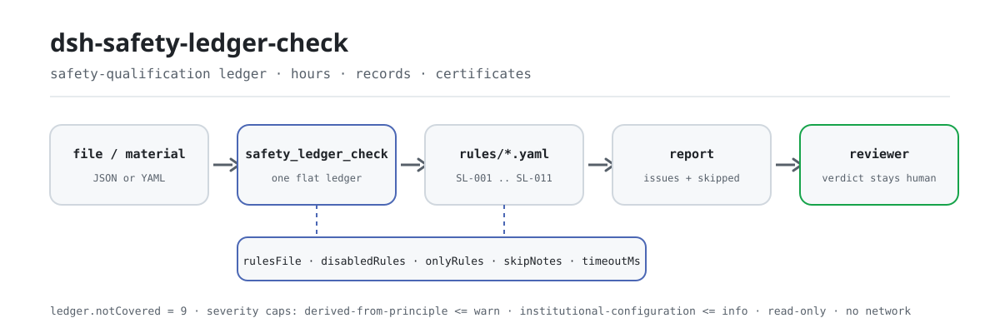

<div align="center">

<picture>
  <source media="(prefers-color-scheme: dark)" srcset="docs/assets/dsh-safety-ledger-check-flow-dark.svg">
  
</picture>

# dsh-safety-ledger-check

**Contrasta el registro de cualificación en seguridad de una obra línea por línea con las cláusulas y obtén la lista de qué fila, qué falta y qué cláusula lo exige: el dictamen queda en manos del revisor.**

Un plugin de verificación de registros para DeepSeek Harness: un registro plano (una fila por persona y evento) se contrasta con un paquete de reglas versionado que revisa horas de formación previa, los cuatro elementos del registro de formación, certificados de operación especial y su vigencia, y los seis meses de prácticas; solo enumera diferencias señalables dentro del material, sin dictamen de cumplimiento ni atribución de responsabilidad.

[Instalar](#instalación-en-tres-pasos) · [Configuración](#configuración) · [FAQ](#faq) · [简体中文](README.md) · [English](README.en.md) · [Español](README.es.md) · [Português](README.pt.md) · [हिन्दी](README.hi.md)

[](LICENSE)
[](#compatibilidad)
[](https://www.npmjs.com/package/dsh-safety-ledger-check)
[](https://github.com/PerryLink/dsh-safety-ledger-check/actions/workflows/ci.yml)
[](#compatibilidad)

[](https://github.com/PerryLink/dsh-safety-ledger-check/stargazers)
[](https://www.npmjs.com/package/dsh-safety-ledger-check)
[](https://dshfind.com/plugins/PerryLink/dsh-safety-ledger-check?ref=badge)
[](https://securityscorecards.dev/viewer/?uri=github.com/PerryLink/dsh-safety-ledger-check)

```sh
dsh plugin --profile <name> add dsh-safety-ledger-check
```

</div>

<sub>Plugin de la comunidad, no afiliado a DeepSeek. Repositorio canónico: <https://github.com/PerryLink/dsh-safety-ledger-check>.</sub>

## Qué es

`dsh-safety-ledger-check` registra la herramienta `safety_ledger_check`: se le entrega el registro (JSON o YAML) y aplica el paquete de reglas incluido línea por línea, devolviendo una lista de diferencias en Markdown y un resultado estructurado. Cada hallazgo lleva id de regla, número de fila, campo, cláusula de base y una acción «revisar»; toda comprobación que no pudo ejecutarse se lista en `skipped` con su motivo.

Comprueba el **registro**, no la obra: solo responde a lo que el material puede demostrar celda a celda, no juzga si fuera del registro se impartió realmente la formación y no atribuye responsabilidad.

- **Para quién**: responsables de seguridad, documentalistas y supervisores de obra; no hace falta usar la línea de comandos.
- **Qué entregas**: un registro de formación en seguridad y cualificación (JSON / YAML; una fila por registro de formación o certificado y persona).
- **Qué recibes**: una lista de diferencias graduada `error` / `warn` / `info` + las comprobaciones de `skipped` + un descargo fijo.

Responde a estas preguntas:

- ¿Alcanzan los nuevos trabajadores las 24 horas de formación previa y los responsables las 32?
- ¿Cada registro de formación lleva fecha, contenido, asistentes y resultado de la evaluación?
- ¿Tienen número de certificado los operarios de operación especial? ¿Seguía vigente el certificado el día trabajado?
- ¿Esperó seis meses quien obtuvo el certificado por primera vez antes de trabajar solo?

**Límite:** verifica el registro, no la obra. No comprueba la autenticidad de un certificado —eso exige la plataforma nacional de supervisión de calidad y seguridad— ni decide si un oficio pertenece al catálogo de operaciones especiales, que se publica aparte en el artículo 2 de la Orden 60. Una celda vacía se informa como «el registro no lo recoge», nunca como «no ocurrió».

## Instalación en tres pasos

1. **Instala** (elige un canal):

   ```sh
   # canal git (último main; equivale a git+https://github.com/PerryLink/dsh-safety-ledger-check.git)
   dsh plugin --profile <name> add github:PerryLink/dsh-safety-ledger-check
   # canal npm (versiones publicadas)
   dsh plugin --profile <name> add dsh-safety-ledger-check
   # canal tarball: pnpm pack en este repo y luego
   dsh plugin --profile <name> add ./dsh-safety-ledger-check-<version>.tgz
   ```

   `main` resuelve a `lib/index.mjs`; el repositorio no versiona el resultado de la compilación, así que ejecuta `pnpm install && pnpm run build` tras instalar o antes de una prueba local.

2. **Configuración mínima** (los valores por defecto ya funcionan; una fila de bundle sin `config` usa todos los valores por defecto y el paquete de reglas incluido en `rules/safety-ledger-check.yaml`):

   ```yaml
   - insert:
       - id: dsh-safety-ledger-check
         name: dsh-safety-ledger-check
   ```

3. **Verifica que se monta**: mira la fila del perfil y ejecuta el ejemplo incluido:

   ```sh
   dsh --profile <name> --dump-config | grep 'dsh-safety-ledger-check'
   pnpm install && pnpm run build
   node samples/quickstart/run.mjs
   # safety_ledger_check: 1 issue(s) — error 1, warn 0, info 0
   # skipped: 0
   ```

   La entrada del ejemplo es `samples/quickstart/input/SL-001-unsafe.yaml` (16 horas previas, por debajo de 24); la salida esperada está en `samples/quickstart/expected/result.json`.

**Desinstalar**: `dsh plugin --profile <name> remove dsh-safety-ledger-check` (o elimina la fila del patch del perfil).

## Capacidades clave

`dsh-safety-ledger-check` separa reglas y código: el paquete de reglas es datos, y sustituir `rules/*.yaml` cambia todo el conjunto de comprobaciones sin tocar una línea de TypeScript.

- **10 reglas en un paquete de datos** — `rules/safety-ledger-check.yaml` (versión `2026.1`, con fecha de referencia `2026-10-24`) cubre horas de formación, los cuatro elementos del registro, número de certificado, vigencia, los seis meses de prácticas y marcadores de plantilla; `dateGap` expresa «válido hasta la fecha de trabajo» como vencimiento menos fecha de trabajo mayor o igual a un día.
- **Comprueba coherencia de campos, no hechos** — los números solo comparan magnitud, las fechas solo comparan orden, los campos solo comprueban presencia; no juzga si el contenido formativo cubre el programa ni si un certificado es auténtico.
- **Una regla se omite a propósito** — el artículo 20 de la Orden 60 exige trabajar «según el oficio certificado», así que cualquier diferencia entre `certTrade` y `workTrade` equivale a trabajar sin certificado. El motor no tiene un tipo de igualdad textual exacta; el más cercano, `sharedTerms`, compara bigramas y puntuaría «operador de grúa torre» y «señalista de grúa torre» como el mismo oficio. En una regla con multa de hasta 100.000 ¥, ese falso negativo es peor que no comprobar, así que SL-009 figura en `notImplemented` con el motivo.
- **Las comprobaciones que no se ejecutan lo dicen** — una columna ausente, una regla desactivada por `disabledRules` o excluida por `onlyRules` acaban en `skipped` con su motivo; un resultado vacío no significa «ningún problema».
- **La gravedad sigue a la evidencia** — `direct` puede llegar a `error`; `derived-from-principle` se limita a `warn` (SL-005); `institutional-configuration` a `info` (SL-011); hay un test que lo asegura.
- **Solo lectura, sin red, sin modelo** — ESM puro: lee el material que le pasas y calcula en memoria; los parámetros de la herramienta son `file` / `material` / `rulesFile` / `only`.

### Ejemplo

Salida esperada del ejemplo incluido (`samples/quickstart/expected/result.json`):

```json
{
  "tool": "safety_ledger_check",
  "issueCount": 1,
  "summary": { "error": 1, "warn": 0, "info": 0 },
  "skippedCount": 0
}
```

*Observed from `samples/quickstart/expected/result.json`; se reproduce con `node samples/quickstart/run.mjs`*

El texto del informe renderizado está hoy en chino (cadenas fijas en `src/view.ts`); los campos estructurados (`summary` / `issueCount` / `skippedCount` / `reportJson`) no dependen del idioma.

## Normas que sigue

Las citas son literales del portal del Gobierno chino (recuperadas el 2026-10-24):

- Normas de formación en seguridad para unidades productivas (Orden n.º 3 de la Administración Estatal de Seguridad Laboral), artículos 9 (32/12 horas), 12 (formación de tres niveles), 13 (24 horas) y 22 (los cuatro elementos del archivo).
- Normas de gestión del personal de operaciones especiales en la construcción (Orden n.º 60 del Ministerio de Vivienda y Desarrollo Urbano-Rural), artículos 3, 14 (validez de 3 años), 20 (trabajar según el oficio certificado) y 22 (seis meses de prácticas).
- Política de archivo de la propia institución (configuración institucional): el requisito de marcadores de plantilla de SL-011 no es una cláusula legal.

**Vigencia:** la Orden 60 se publicó el 2025-12-17 y **entra en vigor el 2026-06-01**; su artículo 45 deroga expresamente la Jianzhi [2008] n.º 75. Toda regla que cite la Orden 75 está obsoleta y este paquete no cita ninguna; para comprobar un registro anterior al 2026-06-01 hay que usar el paquete de reglas antiguo.

Una regla se limita **deliberadamente a `warn`**: el artículo 12 de la Orden n.º 3 habla de «unidades productivas como la transformación y la manufactura» y no nombra a las constructoras. La formación de tres niveles en obra proviene de normas sectoriales y detalles locales, así que el paquete cita el artículo tal cual y lo marca `derived-from-principle` en lugar de inventar una cita específica para la construcción.

## Configuración

Campos Schemastery `Config` de `src/config.ts` (modificables desde cordis.yml). Una sobrescritura por id reemplaza la fila entera: repite cada clave que necesites.

| Clave | Tipo | Predeterminado | Significado |
|---|---|---|---|
| `rulesFile` | string | `rules/safety-ledger-check.yaml` | Ruta del paquete de reglas relativa a la raíz del paquete; también admite una ruta absoluta. Sustituirlo cambia la versión del conjunto de reglas |
| `disabledRules` | string[] | `[]` | Ids de regla a desactivar; cada regla desactivada aparece en `skipped` |
| `onlyRules` | string[] | `[]` | Ejecutar solo estos ids de regla; vacío significa todas |
| `skipNotes` | string | `''` | Nota añadida a cada motivo de `skipped`, p. ej. para citar una norma interna |
| `timeoutMs` | number | `120000` | Presupuesto de tiempo de espera cooperativo de la herramienta, en milisegundos |

Ejemplo de sobrescritura en el patch del perfil:

```yaml
- insert:
    - id: dsh-safety-ledger-check
      name: dsh-safety-ledger-check
      config:
        disabledRules: [SL-011]
        skipNotes: aplicar la política de archivo 2026 de la institución
        timeoutMs: 180000
```

Una llamada a la herramienta también puede pasar `file` o `material` (uno de los dos), sobrescribir el paquete de reglas en esa ejecución con `rulesFile` y limitar las reglas con `only`; esos argumentos no se escriben en el perfil.

## Formato del material

Un registro plano: una fila por persona y registro de formación o certificado. JSON o YAML, con una clave superior `rows` (también se aceptan `items` / `records` y las claves chinas documentadas en `src/model.ts`); la cabecera puede llevar `project` / `unit` / `period` / `checkedAt` / `basis`.

| Columna canónica | Significado |
|---|---|
| `personName` | Persona |
| `trade` | Oficio |
| `educationLevel` | Nivel de la formación de tres niveles (empresa / proyecto / equipo) |
| `trainingHours` / `managerHours` | Horas previas / horas de responsables y técnicos de seguridad |
| `trainingDate` / `trainingContent` / `assessResult` | Tres de los cuatro elementos del registro (el asistente es la propia fila) |
| `certNo` | Número del certificado de operación especial |
| `certTrade` / `workTrade` | Oficio certificado / oficio realmente trabajado |
| `certIssueDate` / `certExpiryDate` | Ventana de vigencia |
| `workDate` / `soloWorkDate` | Fecha de trabajo y primera fecha de trabajo en solitario |
| `remark` | Observaciones |

Los alias de columna se declaran en `COLUMNS` dentro de `src/model.ts`. Cuando el material no trae una columna, las reglas que dependen de ella pasan a `skipped` en lugar de aprobar en silencio.

## Fuentes de las reglas

Los datos de las reglas viven en `rules/safety-ledger-check.yaml`, separados del código: cada regla lleva `document` / `number` / `clause` / `excerpt` / `kind` / `source`, y `excerpt` debe ser una cita literal. Las mismas citas se recogen en `rules/evidence/clauses.md`; `check:citations` (`node scripts/check-citations.mjs`) verifica cada una, de modo que un fragmento nuevo no trazable hace fallar la puerta.

Límites conocidos: los certificados no se verifican contra la plataforma nacional, el catálogo de operaciones especiales no está embebido y solo se cubre uno de los diez registros; los otros nueve se listan por nombre en `ledger.notCovered` del paquete y en el informe.

## FAQ

<details>
<summary>¿Se sube el registro a algún sitio? ¿Dónde viven los datos?</summary>

No. `dsh-safety-ledger-check` es un verificador local: solo lee el `file` / `material` que le pasas a la herramienta, no hace peticiones de red, no incluye telemetría ni analítica y no escribe nada fuera del resultado de la herramienta y del almacenamiento de sesión/registro del propio host DSH; ese almacenamiento y su retención los controla el host, y este paquete no guarda una segunda copia (véase [PRIVACY.md](PRIVACY.md)).

</details>

<details>
<summary>¿Un resultado vacío significa que el registro está bien?</summary>

No. El informe siempre lleva `skipped`: una columna ausente, una regla desactivada por `disabledRules` o excluida por `onlyRules` se lista con su motivo. Una celda vacía informa «el registro no lo recoge», nunca «no ocurrió»; solo cuando todas las reglas declaradas se ejecutaron y `issues` está vacío, esta ejecución no encontró diferencias señalables.

</details>

<details>
<summary>¿Por qué no comprueba la autenticidad del certificado ni la coincidencia de oficio?</summary>

La autenticidad exige la plataforma nacional de supervisión de calidad y seguridad; este plugin lee el registro y no accede a sistemas externos. La coincidencia de oficio (SL-009) se omite a propósito: el artículo 20 de la Orden 60 equipara la discrepancia de oficio certificado con trabajar sin certificado, pero el motor no tiene igualdad textual exacta y la comparación aproximada trataría «operador de grúa torre» y «señalista de grúa torre» como el mismo oficio —un falso negativo peor que no comprobar en una regla de ese peso. Por eso figura en `notImplemented` con el motivo.

</details>

<details>
<summary>¿Compite con otros plugins DSH por nombres de herramienta, claves de servicio o slots?</summary>

No. Solo declara `inject: ['tools']` y registra una herramienta, `safety_ledger_check`; no provee ninguna clave de servicio, no registra slots de cliente, ni prefijos `webServer`, ni listeners de eventos de sesión, y no muta globales; el patch del bundle solo hace `insert` de su propia fila. Véase «Interoperabilidad con otros plugins DSH».

</details>

<details>
<summary>¿Cuánto coste de rendimiento supone?</summary>

Una ejecución = leer un JSON/YAML + aplicar las reglas fila a fila en memoria, sin peticiones de red ni llamadas al modelo. El coste escala con el número de filas y reglas; `timeoutMs` (120 segundos por defecto) es el presupuesto cooperativo de la herramienta, no una interrupción forzosa.

</details>

## Solución de problemas

- **El plugin se instala pero la herramienta no aparece**: comprueba que `main` resuelve a `lib/index.mjs` y que `pnpm run build` lo generó.
- **`dsh plugin add` rechaza el paquete por incompatibilidad**: el paquete declara `engines.dsh` `>=0.2.1-0 <0.3.0`; fuera de ese rango, concede una exención explícita o fija la versión del host en el perfil.
- **Una regla no se ejecutó**: lee el array `skipped` del resultado; una columna ausente, una regla desactivada o una regla no seleccionada indican allí su motivo.

## Límites de seguridad y limitaciones conocidas

- **Comprueba el registro, no la obra.** Solo responde a lo que el material puede señalar; si la formación fuera del registro se impartió de verdad queda fuera del alcance.
- **Sin verificación de autenticidad.** Eso exige la plataforma nacional de supervisión; este plugin lee el registro que le pasas y no accede a sistemas externos.
- **Sin catálogo de operaciones especiales.** Si un oficio pertenece al catálogo se publica aparte en el artículo 2 de la Orden 60, y el paquete no lo embebe.
- **Una celda vacía no es «no ocurrió».** Informa «el registro no lo recoge»; un registro ausente solo significa que el registro no puede probarlo, no que la obra lo omitiera.
- **Sin dictamen de cumplimiento, sin atribución de responsabilidad, sin sustituir al revisor.** Un guardián de redacción (`src/shared/wording.ts`) recorre el informe renderizado, que siempre lleva el descargo; la conclusión profesional queda en manos de la persona responsable.
- **La gravedad tiene topes.** `derived-from-principle` se limita a `warn`, `institutional-configuration` a `info`, y un test lo asegura.
- **Solo lectura.** Sin peticiones de red, sin credenciales almacenadas, sin llamadas al modelo, sin escritura de archivos; nada se conserva más allá del resultado de la herramienta y del almacenamiento del host (véanse [PRIVACY.md](PRIVACY.md) y [SECURITY.md](SECURITY.md)).
- **Una regla no está implementada.** SL-009 (trabajar según el oficio certificado) figura en `notImplemented`: el motor no tiene una comprobación de igualdad exacta entre dos campos de texto y la comparación aproximada produciría un falso negativo de alto riesgo.
- **Se cubre uno de los diez registros.** Los otros nueve se nombran en `ledger.notCovered` del paquete y en el informe.
- **Las reglas envejecen.** La Orden 60 entró en vigor el 2026-06-01 y derogó la Jianzhi [2008] n.º 75; para un registro anterior hay que usar el paquete antiguo.
- **El informe renderizado está hoy en chino.** Las cadenas Markdown de `src/view.ts` son chinas fijas; los campos estructurados (`summary` / `issueCount` / `skippedCount` / `reportJson`) no dependen del idioma.

### Interoperabilidad con otros plugins DSH

Este plugin hace una sola cosa y no ocupa recursos compartidos:

- **Un único registro de herramienta** — `safety_ledger_check`, con `inject: ['tools']`; el resultado vuelve solo a quien llama.
- **Sin colisión de clave de servicio** — no provee ninguna clave de servicio.
- **Sin colisión de slot ni de ruta** — no registra claves de slot de cliente ni prefijos `webServer`.
- **Sin colisión de eventos** — no escucha eventos de sesión ni entra en cadenas de eventos.
- **Sin colisión en la capa de patch** — `cordis.patch.yml` solo hace `insert` de su propia fila y nunca sobrescribe el `config` de una fila incluida.
- **Sin mutación global** — no parchea prototipos, no reescribe `process.env` ni reemplaza el dispatcher global de fetch.

## Compatibilidad

| Superficie | Estado |
|---|---|
| Harness | `engines.dsh`: `>=0.2.1-0 <0.3.0`; peer `@deepseek-ai/dsh-tools`: `>=0.1.2-rc.1 <0.2.0 \|\| >=0.2.0-0 <0.3.0` |
| Node | `^22.19.0 \|\| >=24.0.0` |
| Plataformas | Todas (ESM puro; sin código nativo, sin red, sin llamadas al modelo) |
| Material | JSON o YAML, UTF-8; una fila por registro de formación o certificado y persona |

## Ecosistema y calidad

- [Página del plugin en dshfind](https://dshfind.com/plugins/PerryLink/dsh-safety-ledger-check) (instalaciones y ranking)
- [Informe de OpenSSF Scorecard](https://securityscorecards.dev/viewer/?uri=github.com/PerryLink/dsh-safety-ledger-check) (impulsado por [.github/workflows/scorecard.yml](.github/workflows/scorecard.yml))
- [Base de conocimiento del ecosistema](https://perrylink.github.io/dsh-plugin-guide/): guía de desarrollo de plugins · datos de selección · criterios de mantenimiento
- Índice completo de la familia: [elegir un verificador por material](https://perrylink.github.io/zh/checkers/choose/) · [todos los plugins](https://github.com/PerryLink)

## Desarrollo

```sh
pnpm install                                        # node ^22.19 || >=24
pnpm run typecheck                                  # tsc --noEmit
pnpm test                                           # vitest: 33 pruebas
pnpm run build                                      # tsdown -> lib/index.mjs + lib/index.d.mts
pnpm run verify:self-contained                      # las specs de dependencias se resuelven desde el registry
pnpm run check:lockfile                             # comprobación de deriva del lockfile
pnpm run check:readmes                              # consistencia de los README en cinco idiomas
pnpm run check:citations                            # línea base de citas del paquete de reglas
node ../scripts/sync-shared.mjs dsh-safety-ledger-check   # refrescar src/shared desde ../_shared
pnpm pack                                           # el tarball publicado
```

Prueba local del ejemplo (requiere `pnpm run build` para producir `lib/`):

```sh
node samples/quickstart/run.mjs
# safety_ledger_check: 1 issue(s) — error 1, warn 0, info 0
# skipped: 0
```

Estructura del directorio:

| Ruta | Función |
|---|---|
| `src/index.ts` | Contrato de plugin de función: registra `safety_ledger_check` y resuelve el paquete de reglas incluido |
| `src/config.ts` | Configuración Schemastery (`rulesFile` / `disabledRules` / `onlyRules` / `skipNotes` / `timeoutMs`) |
| `src/model.ts` | Definición y alias de columnas del registro, análisis del material y entrada `runCheck` |
| `src/view.ts` | Proyección del informe para el modelo (Markdown + `reportJson`) |
| `src/shared/` | Kit compartido (carga de reglas, motor de tablas, aritmética de fechas, guardián de redacción) |
| `rules/` | Paquete de reglas y registro de verificación de cláusulas en `evidence/` |
| `samples/quickstart/` | Ejemplo incluido, salida esperada y script de ejecución |
| `tests/` | vitest: un par de fixtures conforme/infractor por regla |
| `scripts/` | Puertas de citas, lockfile, autocontención y README en cinco idiomas |

Las imágenes del README se generan programáticamente con [`scripts/gen-readme-assets.py`](scripts/gen-readme-assets.py) (Python + Pillow) y se pueden reejecutar; el diagrama de flujo, el hero y la demo de una sola piel anteriores se conservan en `docs/assets/` para enlaces externos, mientras que los README solo referencian el nuevo par claro/oscuro.

Topics: `deepseek-harness`, `dsh`, `dsh-plugin`, `cordis`, `safety`, `ledger`, `training`, `certificate`

## Familia y agradecimientos

Este proyecto forma parte de la familia de plugins de DeepSeek Harness de [PerryLink](https://github.com/PerryLink) (todos Apache-2.0). Índice completo: [elegir un verificador por material](https://perrylink.github.io/zh/checkers/choose/) y [todos los plugins](https://github.com/PerryLink). Si te resulta útil, **una estrella ayuda a que la siguiente persona lo encuentre** — no hay nada bloqueado tras ella.

- [@PerryLink](https://github.com/PerryLink) — creador y mantenedor: el paquete de reglas (SL-001..SL-011), la herramienta `safety_ledger_check`, el registro de verificación de citas y la documentación en cinco idiomas.

<details>
<summary>Ver todos los plugins</summary>

| Plugin | Estado |
|---|---|
| **[dsh-aqua-input-check](https://github.com/PerryLink/dsh-aqua-input-check)** |  |
| **[dsh-archive-check](https://github.com/PerryLink/dsh-archive-check)** |  |
| **[dsh-auto-review](https://github.com/PerryLink/dsh-auto-review)** |  |
| **[dsh-autotier](https://github.com/PerryLink/dsh-autotier)** | 🧊 CONGELADO — ver el README del repo |
| **[dsh-bid-ca-precheck](https://github.com/PerryLink/dsh-bid-ca-precheck)** |  |
| **[dsh-bid-qual-check](https://github.com/PerryLink/dsh-bid-qual-check)** |  |
| **[dsh-cert-mcp](https://github.com/PerryLink/dsh-cert-mcp)** | 🧊 CONGELADO — ver el README del repo |
| **[dsh-checkpoint-rewind](https://github.com/PerryLink/dsh-checkpoint-rewind)** |  |
| **[dsh-click](https://github.com/PerryLink/dsh-click)** |  |
| **[dsh-composer-history](https://github.com/PerryLink/dsh-composer-history)** |  |
| **[dsh-contract-stance](https://github.com/PerryLink/dsh-contract-stance)** |  |
| **[dsh-customs-doc-check](https://github.com/PerryLink/dsh-customs-doc-check)** |  |
| **[dsh-data-quality](https://github.com/PerryLink/dsh-data-quality)** | 🧊 CONGELADO — ver el README del repo |
| **[dsh-demurrage-ledger](https://github.com/PerryLink/dsh-demurrage-ledger)** |  |
| **[dsh-doublecheck](https://github.com/PerryLink/dsh-doublecheck)** |  |
| **[dsh-drill-script-check](https://github.com/PerryLink/dsh-drill-script-check)** |  |
| **[dsh-eia-guide-check](https://github.com/PerryLink/dsh-eia-guide-check)** |  |
| **[dsh-emergency-plan](https://github.com/PerryLink/dsh-emergency-plan)** |  |
| **[dsh-essay-rubric-check](https://github.com/PerryLink/dsh-essay-rubric-check)** |  |
| **[dsh-evidence-check](https://github.com/PerryLink/dsh-evidence-check)** |  |
| **[dsh-export-ctl-check](https://github.com/PerryLink/dsh-export-ctl-check)** |  |
| **[dsh-fast](https://github.com/PerryLink/dsh-fast)** |  |
| **[dsh-fmea-table-check](https://github.com/PerryLink/dsh-fmea-table-check)** |  |
| **[dsh-forecast-penalty](https://github.com/PerryLink/dsh-forecast-penalty)** |  |
| **[dsh-fund-research](https://github.com/PerryLink/dsh-fund-research)** |  |
| **[dsh-github](https://github.com/PerryLink/dsh-github)** |  |
| **[dsh-gongwen-flow-check](https://github.com/PerryLink/dsh-gongwen-flow-check)** |  |
| **[dsh-gongwen-word-check](https://github.com/PerryLink/dsh-gongwen-word-check)** |  |
| **[dsh-guard-plan-qc](https://github.com/PerryLink/dsh-guard-plan-qc)** |  |
| **[dsh-hazchem-check](https://github.com/PerryLink/dsh-hazchem-check)** |  |
| **[dsh-hazplan-check](https://github.com/PerryLink/dsh-hazplan-check)** |  |
| **[dsh-hidden-risk-map](https://github.com/PerryLink/dsh-hidden-risk-map)** |  |
| **[dsh-hs-classify](https://github.com/PerryLink/dsh-hs-classify)** |  |
| **[dsh-icd-rule-check](https://github.com/PerryLink/dsh-icd-rule-check)** |  |
| **[dsh-industry-research](https://github.com/PerryLink/dsh-industry-research)** |  |
| **[dsh-lawcite-adapter](https://github.com/PerryLink/dsh-lawcite-adapter)** |  |
| **[dsh-laya](https://github.com/PerryLink/dsh-laya)** |  |
| **[dsh-lc-doc-check](https://github.com/PerryLink/dsh-lc-doc-check)** |  |
| **[dsh-learning-gap-check](https://github.com/PerryLink/dsh-learning-gap-check)** |  |
| **[dsh-library](https://github.com/PerryLink/dsh-library)** |  |
| **[dsh-local-ai](https://github.com/PerryLink/dsh-local-ai)** |  |
| **[dsh-lsp-actions](https://github.com/PerryLink/dsh-lsp-actions)** |  |
| **[dsh-mask](https://github.com/PerryLink/dsh-mask)** |  |
| **[dsh-mcp-panel](https://github.com/PerryLink/dsh-mcp-panel)** |  |
| **[dsh-medrec-qc](https://github.com/PerryLink/dsh-medrec-qc)** |  |
| **[dsh-memento](https://github.com/PerryLink/dsh-memento)** | 🧊 CONGELADO — ver el README del repo |
| **[dsh-nsfc-form-check](https://github.com/PerryLink/dsh-nsfc-form-check)** |  |
| **[dsh-nurse-record-check](https://github.com/PerryLink/dsh-nurse-record-check)** |  |
| **[dsh-observe](https://github.com/PerryLink/dsh-observe)** |  |
| **[dsh-origin-rvc-check](https://github.com/PerryLink/dsh-origin-rvc-check)** |  |
| **[dsh-ota-review-check](https://github.com/PerryLink/dsh-ota-review-check)** |  |
| **[dsh-output-styles](https://github.com/PerryLink/dsh-output-styles)** |  |
| **[dsh-paper-doc-adapter](https://github.com/PerryLink/dsh-paper-doc-adapter)** |  |
| **[dsh-permission-rules](https://github.com/PerryLink/dsh-permission-rules)** |  |
| **[dsh-permit-report-check](https://github.com/PerryLink/dsh-permit-report-check)** |  |
| **[dsh-pipeline-check](https://github.com/PerryLink/dsh-pipeline-check)** |  |
| **[dsh-pleading-draft](https://github.com/PerryLink/dsh-pleading-draft)** |  |
| **[dsh-plugin-doctor](https://github.com/PerryLink/dsh-plugin-doctor)** | 🚫 RETIRADO (repo archivado) |
| **[dsh-plugin-guide](https://github.com/PerryLink/dsh-plugin-guide)** |  |
| **[dsh-plugin-kit](https://github.com/PerryLink/dsh-plugin-kit)** | 🚫 RETIRADO (repo archivado) |
| **[dsh-plugin-upgrade](https://github.com/PerryLink/dsh-plugin-upgrade)** | 🚫 RETIRADO (repo archivado) |
| **[dsh-policy-brief-draft](https://github.com/PerryLink/dsh-policy-brief-draft)** |  |
| **[dsh-power-loss-split](https://github.com/PerryLink/dsh-power-loss-split)** |  |
| **[dsh-power-ticket-check](https://github.com/PerryLink/dsh-power-ticket-check)** |  |
| **[dsh-ppap-check](https://github.com/PerryLink/dsh-ppap-check)** |  |
| **[dsh-protest-deadline](https://github.com/PerryLink/dsh-protest-deadline)** |  |
| **[dsh-railway-window](https://github.com/PerryLink/dsh-railway-window)** |  |
| **[dsh-repair-order-qc](https://github.com/PerryLink/dsh-repair-order-qc)** |  |
| **[dsh-research-report](https://github.com/PerryLink/dsh-research-report)** |  |
| **[dsh-review-reply-check](https://github.com/PerryLink/dsh-review-reply-check)** |  |
| **[dsh-rulefile-check](https://github.com/PerryLink/dsh-rulefile-check)** |  |
| **[dsh-safety-brief-check](https://github.com/PerryLink/dsh-safety-brief-check)** |  |
| **[dsh-score](https://github.com/PerryLink/dsh-score)** | 🧊 CONGELADO — ver el README del repo |
| **[dsh-session-sync](https://github.com/PerryLink/dsh-session-sync)** |  |
| **[dsh-site-log-check](https://github.com/PerryLink/dsh-site-log-check)** |  |
| **[dsh-skill-pack-security](https://github.com/PerryLink/dsh-skill-pack-security)** |  |
| **[dsh-soe-decision-check](https://github.com/PerryLink/dsh-soe-decision-check)** |  |
| **[dsh-soilwater-check](https://github.com/PerryLink/dsh-soilwater-check)** |  |
| **[dsh-sop-sync-check](https://github.com/PerryLink/dsh-sop-sync-check)** |  |
| **[dsh-spc-gbt-adapter](https://github.com/PerryLink/dsh-spc-gbt-adapter)** |  |
| **[dsh-talk](https://github.com/PerryLink/dsh-talk)** |  |
| **[dsh-tender-extract](https://github.com/PerryLink/dsh-tender-extract)** |  |
| **[dsh-tender-matrix](https://github.com/PerryLink/dsh-tender-matrix)** |  |
| **[dsh-test-drive](https://github.com/PerryLink/dsh-test-drive)** |  |
| **[dsh-ticktick](https://github.com/PerryLink/dsh-ticktick)** | 🚫 RETIRADO (repo archivado) |
| **[dsh-translate](https://github.com/PerryLink/dsh-translate)** |  |
| **[dsh-warranty-calc](https://github.com/PerryLink/dsh-warranty-calc)** |  |
| **[dsh-budget](https://github.com/PerryLink/dsh-budget)** | 🧊 CONGELADO — ver el README del repo |
| **[dsh-claude-move](https://github.com/PerryLink/dsh-claude-move)** | 🧊 CONGELADO — ver el README del repo |
| **[dsh-defend](https://github.com/PerryLink/dsh-defend)** | 🧊 CONGELADO — ver el README del repo |
| **[dsh-draw](https://github.com/PerryLink/dsh-draw)** | 🧊 CONGELADO — ver el README del repo |
| **[dsh-reach](https://github.com/PerryLink/dsh-reach)** | 🧊 CONGELADO — ver el README del repo |
| **[dsh-background-agents](https://github.com/PerryLink/dsh-background-agents)** | 🚫 RETIRADO (repo archivado) |
| **[dsh-session-pin](https://github.com/PerryLink/dsh-session-pin)** | 🚫 RETIRADO (repo archivado) |
| **[dsh-team-rooms](https://github.com/PerryLink/dsh-team-rooms)** | 🚫 RETIRADO (repo archivado) |

</details>

## Licencia

[LICENSE](LICENSE) (Apache License 2.0) © 2026 dsh-safety-ledger-check contributors

<p align="center"><sub>Apache-2.0 · Plugin de la comunidad, no afiliado a DeepSeek.</sub></p>
