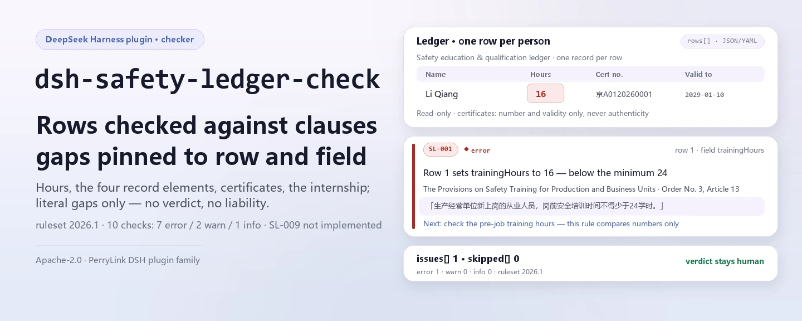
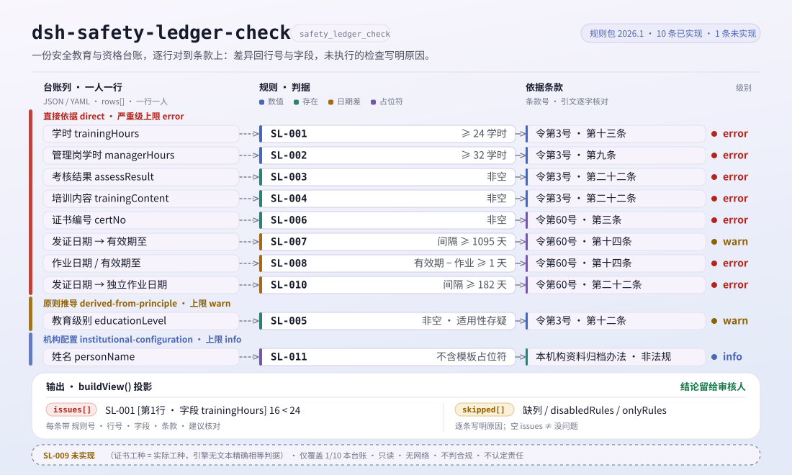

<div align="center">

<picture>
  <source media="(prefers-color-scheme: dark)" srcset="docs/assets/dsh-safety-ledger-check-hero-en-dark.webp">
  
</picture>

# dsh-safety-ledger-check

**निर्माण सुरक्षा-योग्यता रजिस्टर को पंक्ति-दर-पंक्ति धाराओं से मिलाएँ और पाएँ कि कौन-सी पंक्ति, क्या अनुपस्थित है और कौन-सी धारा उसकी माँग करती है — निर्णय समीक्षक का ही रहता है।**

DeepSeek Harness के लिए रजिस्टर-जाँच प्लगइन: एक सपाट रजिस्टर (प्रति व्यक्ति प्रति घटना एक पंक्ति) एक संस्करणबद्ध नियम-पैक से मिलाया जाता है, जो पूर्व-नियुक्ति प्रशिक्षण घंटे, प्रशिक्षण रिकॉर्ड के चार तत्व, विशेष-संचालन प्रमाणपत्र व उनकी वैधता और छह माह का इंटर्नशिप जाँचता है; केवल सामग्री में इंगित की जा सकने वाली भिन्नताएँ सूचीबद्ध करता है, कोई अनुपालन निर्णय या दायित्व-निर्धारण नहीं।

[इंस्टॉल](#तीन-चरणों-में-शुरुआत) · [कॉन्फ़िगरेशन](#कॉन्फ़िगरेशन) · [FAQ](#faq) · [简体中文](README.md) · [English](README.en.md) · [Español](README.es.md) · [Português](README.pt.md) · [हिन्दी](README.hi.md)

[](LICENSE)
[](#अनुकूलता)
[](https://www.npmjs.com/package/dsh-safety-ledger-check)
[](https://github.com/PerryLink/dsh-safety-ledger-check/actions/workflows/ci.yml)
[](#अनुकूलता)

[](https://github.com/PerryLink/dsh-safety-ledger-check/stargazers)
[](https://www.npmjs.com/package/dsh-safety-ledger-check)
[](https://dshfind.com/plugins/PerryLink/dsh-safety-ledger-check?ref=badge)
[](https://securityscorecards.dev/viewer/?uri=github.com/PerryLink/dsh-safety-ledger-check)

```sh
dsh plugin --profile <name> add dsh-safety-ledger-check
```

</div>

<sub>समुदाय प्लगइन, DeepSeek से संबद्ध नहीं। एकमात्र रेपो: <https://github.com/PerryLink/dsh-safety-ledger-check>।</sub>

## यह क्या है

`dsh-safety-ledger-check` `safety_ledger_check` टूल पंजीकृत करता है: रजिस्टर (JSON या YAML) दें और यह बंडल किए गए नियम-पैक को पंक्ति-दर-पंक्ति लागू करके Markdown अंतर-सूची और संरचित परिणाम लौटाता है। हर निष्कर्ष में नियम आईडी, पंक्ति संख्या, फ़ील्ड, आधार धारा और «जाँचें» क्रिया होती है; जो जाँच नहीं चल सकीं वे `skipped` में कारण के साथ आती हैं।

यह **रजिस्टर** जाँचता है, साइट नहीं: केवल वही बताता है जो सामग्री सेल-दर-सेल सिद्ध कर सकती है, रजिस्टर के बाहर प्रशिक्षण हुआ या नहीं यह नहीं आँकता, और कोई दायित्व निर्धारित नहीं करता।

- **किसके लिए**: निर्माण सुरक्षा अधिकारी, दस्तावेज़ प्रबंधक और पर्यवेक्षक; कमांड लाइन की ज़रूरत नहीं।
- **आप क्या देते हैं**: एक सुरक्षा-प्रशिक्षण और योग्यता रजिस्टर (JSON / YAML; प्रति व्यक्ति प्रति प्रशिक्षण रिकॉर्ड या प्रमाणपत्र एक पंक्ति)।
- **आपको क्या मिलता है**: `error` / `warn` / `info` श्रेणीबद्ध अंतर-सूची + `skipped` जाँचें + निश्चित अस्वीकरण।

यह इन प्रश्नों का उत्तर देता है:

- नए कर्मचारी 24 घंटे और प्रबंधक 32 घंटे के पूर्व-नियुक्ति प्रशिक्षण तक पहुँचते हैं?
- हर प्रशिक्षण रिकॉर्ड में समय, सामग्री, प्रतिभागी और मूल्यांकन परिणाम है?
- विशेष-संचालन कर्मियों का प्रमाणपत्र क्रमांक दर्ज है? काम के दिन प्रमाणपत्र वैध था?
- पहली बार प्रमाणपत्र लेने वाले ने अकेले काम करने से पहले छह माह का इंटर्नशिप पूरा किया?

**सीमा:** यह रजिस्टर जाँचता है, साइट नहीं। प्रमाणपत्र की प्रामाणिकता नहीं जाँचता — उसके लिए राष्ट्रीय गुणवत्ता-सुरक्षा पर्यवेक्षण मंच चाहिए — और यह भी तय नहीं करता कि कोई व्यवसाय विशेष-संचालन सूची में है या नहीं, जो आदेश 60 के अनुच्छेद 2 में अलग प्रकाशित है। खाली सेल «रजिस्टर में दर्ज नहीं» बताता है, «हुआ ही नहीं» नहीं।

<picture>
  <source media="(prefers-color-scheme: dark)" srcset="docs/assets/dsh-safety-ledger-check-flow-v5-dark.svg">
  
</picture>

## तीन चरणों में शुरुआत

1. **इंस्टॉल करें** (एक चैनल चुनें):

   ```sh
   # git चैनल (नवीनतम main; git+https://github.com/PerryLink/dsh-safety-ledger-check.git के बराबर)
   dsh plugin --profile <name> add github:PerryLink/dsh-safety-ledger-check
   # npm चैनल (प्रकाशित संस्करण)
   dsh plugin --profile <name> add dsh-safety-ledger-check
   # tarball चैनल: इस रेपो में pnpm pack के बाद
   dsh plugin --profile <name> add ./dsh-safety-ledger-check-<version>.tgz
   ```

   `main` `lib/index.mjs` की ओर इंगित करता है; रेपो बिल्ड आउटपुट संस्करण नहीं करता, इसलिए इंस्टॉल के बाद या स्थानीय नमूना चलाने से पहले `pnpm install && pnpm run build` चलाएँ।

2. **न्यूनतम कॉन्फ़िगरेशन** (डिफ़ॉल्ट ही काम करते हैं; `config` के बिना bundle पंक्ति सभी डिफ़ॉल्ट और `rules/safety-ledger-check.yaml` वाला बंडल नियम-पैक लेती है):

   ```yaml
   - insert:
       - id: dsh-safety-ledger-check
         name: dsh-safety-ledger-check
   ```

3. **जाँचें कि माउंट हुआ**: प्रोफ़ाइल पंक्ति देखें, फिर बंडल नमूना चलाएँ:

   ```sh
   dsh --profile <name> --dump-config | grep 'dsh-safety-ledger-check'
   pnpm install && pnpm run build
   node samples/quickstart/run.mjs
   # safety_ledger_check: 1 issue(s) — error 1, warn 0, info 0
   # skipped: 0
   ```

   नमूना इनपुट `samples/quickstart/input/SL-001-unsafe.yaml` है (पूर्व-नियुक्ति 16 घंटे, 24 से कम); अपेक्षित आउटपुट `samples/quickstart/expected/result.json` में है।

**अनइंस्टॉल**: `dsh plugin --profile <name> remove dsh-safety-ledger-check` (या प्रोफ़ाइल patch से वह पंक्ति हटाएँ)।

## मुख्य क्षमताएँ

`dsh-safety-ledger-check` नियमों और कोड को अलग रखता है: नियम-पैक डेटा है, और `rules/*.yaml` बदलने से पूरा जाँच-समूह बदल जाता है, TypeScript की एक पंक्ति छुए बिना।

- **एक डेटा-पैक में 10 नियम** — `rules/safety-ledger-check.yaml` (संस्करण `2026.1`, संदर्भ तिथि `2026-10-24`) प्रशिक्षण घंटे, रिकॉर्ड के चार तत्व, प्रमाणपत्र क्रमांक, वैधता, छह माह इंटर्नशिप और टेम्पलेट प्लेसहोल्डर कवर करता है; `dateGap` «काम की तिथि तक वैध» को समाप्ति घटा कार्य-तिथि ≥ 1 दिन के रूप में व्यक्त करता है।
- **फ़ील्ड की संगति जाँचता है, तथ्य नहीं** — संख्याएँ केवल परिमाण, तिथियाँ केवल क्रम, फ़ील्ड केवल उपस्थिति की तुलना करते हैं; प्रशिक्षण सामग्री पाठ्यक्रम को कवर करती है या नहीं, या प्रमाणपत्र असली है या नहीं, यह नहीं आँकता।
- **एक नियम जानबूझकर छोड़ा गया** — आदेश 60 का अनुच्छेद 20 «प्रमाणपत्र में लिखे व्यवसाय के अनुसार काम» की माँग करता है, इसलिए `certTrade` और `workTrade` में कोई भी अंतर बिना प्रमाणपत्र काम करने के बराबर है। इंजन में दो टेक्स्ट फ़ील्ड की सटीक समानता का प्रकार नहीं है; निकटतम `sharedTerms` बाइग्राम तुलना करता है और «टावर क्रेन ऑपरेटर» तथा «टावर क्रेन सिग्नलर» को एक ही व्यवसाय मान लेगा। ₹/¥1,00,000 तक जुर्माने वाले नियम पर ऐसा फ़ॉल्स-नेगेटिव जाँच न करने से भी बुरा है, इसलिए SL-009 कारण के साथ `notImplemented` में सूचीबद्ध है।
- **जो जाँच नहीं चली वह बताती है** — कॉलम अनुपस्थित, `disabledRules` से बंद नियम, या `onlyRules` से बाहर किया नियम — सभी कारण के साथ `skipped` में जाते हैं; खाली परिणाम «कोई समस्या नहीं» नहीं है।
- **गंभीरता साक्ष्य के अनुसार** — `direct` `error` तक पहुँच सकता है; `derived-from-principle` अधिकतम `warn` (SL-005); `institutional-configuration` अधिकतम `info` (SL-011); एक टेस्ट इसे सिद्ध करता है।
- **केवल पढ़ता है, नेटवर्क नहीं, मॉडल कॉल नहीं** — शुद्ध ESM: आपकी दी सामग्री पढ़कर मेमोरी में गणना करता है; टूल पैरामीटर `file` / `material` / `rulesFile` / `only` हैं।

### उदाहरण

बंडल नमूने का अपेक्षित आउटपुट (`samples/quickstart/expected/result.json`):

```json
{
  "tool": "safety_ledger_check",
  "issueCount": 1,
  "summary": { "error": 1, "warn": 0, "info": 0 },
  "skippedCount": 0
}
```

*Observed from `samples/quickstart/expected/result.json`; `node samples/quickstart/run.mjs` से दोबारा चलाएँ*

रेंडर किया गया रिपोर्ट टेक्स्ट आज चीनी में है (`src/view.ts` की स्थिर स्ट्रिंग्स); संरचित फ़ील्ड (`summary` / `issueCount` / `skippedCount` / `reportJson`) भाषा-निरपेक्ष हैं।

## जिन मानकों का पालन होता है

उद्धरण चीनी सरकारी पोर्टल से शब्दशः लिए गए हैं (2026-10-24 को प्राप्त):

- उत्पादन इकाइयों के लिए सुरक्षा प्रशिक्षण नियम (राज्य कार्य-सुरक्षा प्रशासन आदेश 3), अनुच्छेद 9 (32/12 घंटे), 12 (तीन-स्तरीय प्रशिक्षण), 13 (24 घंटे) और 22 (अभिलेख के चार तत्व)।
- निर्माण में विशेष-संचालन कर्मियों के प्रबंधन नियम (आवास और शहरी-ग्रामीण विकास मंत्रालय आदेश 60), अनुच्छेद 3, 14 (3 वर्ष की वैधता), 20 (प्रमाणित व्यवसाय के अनुसार काम) और 22 (छह माह इंटर्नशिप)।
- संस्था की स्वयं की अभिलेख नीति (संस्थागत कॉन्फ़िगरेशन): SL-011 की टेम्पलेट-प्लेसहोल्डर आवश्यकता कानूनी धारा नहीं है।

**प्रभावीता:** आदेश 60 2025-12-17 को प्रकाशित हुआ और **2026-06-01 से प्रभावी** है; इसका अनुच्छेद 45 जियान्झी [2008] संख्या 75 को स्पष्ट रूप से निरस्त करता है। आदेश 75 का उल्लेख करने वाले नियम पुराने हैं और यह पैक किसी को उद्धृत नहीं करता; 2026-06-01 से पहले का रजिस्टर जाँचने के लिए पुराना नियम-पैक चाहिए।

एक नियम **जानबूझकर केवल `warn` तक** है: आदेश 3 का अनुच्छेद 12 «प्रसंस्करण, विनिर्माण आदि उत्पादन इकाइयों» की बात करता है और निर्माण कंपनियों का नाम नहीं लेता। निर्माण साइट पर तीन-स्तरीय प्रशिक्षण उद्योग नियमों और स्थानीय विवरण से आता है, इसलिए पैक अनुच्छेद को जैसा है वैसा उद्धृत करता है और `derived-from-principle` चिह्नित करता है, निर्माण-विशिष्ट उद्धरण गढ़ता नहीं।

## कॉन्फ़िगरेशन

`src/config.ts` में Schemastery `Config` फ़ील्ड (cordis.yml से बदले जा सकते हैं)। आईडी-आधारित ओवरराइड पूरी पंक्ति बदल देता है — ज़रूरी सभी कुंजियाँ दोहराएँ।

| कुंजी | प्रकार | डिफ़ॉल्ट | अर्थ |
|---|---|---|---|
| `rulesFile` | string | `rules/safety-ledger-check.yaml` | प्लगइन पैकेज रूट के सापेक्ष नियम-पैक पथ; निरपेक्ष पथ भी चलता है। इसे बदलने से नियम-समूह का संस्करण बदलता है |
| `disabledRules` | string[] | `[]` | बंद करने वाले नियम आईडी; हर बंद नियम रिपोर्ट के `skipped` में आता है |
| `onlyRules` | string[] | `[]` | केवल ये नियम आईडी चलाएँ; खाली का अर्थ सभी नियम |
| `skipNotes` | string | `''` | हर `skipped` कारण के बाद जोड़ा जाने वाला नोट, जैसे स्थानीय कार्यान्वयन नियम बताने के लिए |
| `timeoutMs` | number | `120000` | टूल का सहयोगात्मक टाइमआउट बजट, मिलीसेकंड में |

प्रोफ़ाइल patch में ओवरराइड का उदाहरण:

```yaml
- insert:
    - id: dsh-safety-ledger-check
      name: dsh-safety-ledger-check
      config:
        disabledRules: [SL-011]
        skipNotes: संस्था की 2026 अभिलेख नीति के अनुसार चलाएँ
        timeoutMs: 180000
```

टूल कॉल में `file` या `material` (दोनों में से एक) भी दिया जा सकता है, `rulesFile` से उस एक बार के लिए नियम-पैक बदला जा सकता है, और `only` से नियम सीमित किए जा सकते हैं; ये आर्ग्युमेंट प्रोफ़ाइल में नहीं लिखे जाते।

## सामग्री प्रारूप

एक सपाट रजिस्टर: प्रति व्यक्ति प्रति प्रशिक्षण रिकॉर्ड या प्रमाणपत्र एक पंक्ति। JSON या YAML, शीर्ष स्तर पर `rows` कुंजी ( `items` / `records` और `src/model.ts` में दर्ज चीनी कुंजियाँ भी स्वीकार्य); हेडर में `project` / `unit` / `period` / `checkedAt` / `basis` हो सकते हैं।

| कैनोनिकल कॉलम | अर्थ |
|---|---|
| `personName` | व्यक्ति |
| `trade` | कार्य-व्यवसाय |
| `educationLevel` | तीन-स्तरीय प्रशिक्षण का स्तर (कंपनी / परियोजना / टीम) |
| `trainingHours` / `managerHours` | पूर्व-नियुक्ति घंटे / प्रबंधक और सुरक्षा अधिकारी घंटे |
| `trainingDate` / `trainingContent` / `assessResult` | प्रशिक्षण रिकॉर्ड के चार तत्वों में से तीन (प्रतिभागी स्वयं पंक्ति है) |
| `certNo` | विशेष-संचालन प्रमाणपत्र क्रमांक |
| `certTrade` / `workTrade` | प्रमाणपत्र का व्यवसाय / वास्तव में किया गया व्यवसाय |
| `certIssueDate` / `certExpiryDate` | वैधता अवधि |
| `workDate` / `soloWorkDate` | कार्य तिथि, और पहली बार अकेले काम की तिथि |
| `remark` | टिप्पणी |

कॉलम उपनाम `src/model.ts` के `COLUMNS` में घोषित हैं। जब सामग्री में कोई कॉलम नहीं होता, उस पर निर्भर नियम `skipped` में जाते हैं, चुपचाप पास नहीं होते।

## नियमों के स्रोत

नियम डेटा `rules/safety-ledger-check.yaml` में कोड से अलग रहता है: हर नियम में `document` / `number` / `clause` / `excerpt` / `kind` / `source` होते हैं, और `excerpt` शब्दशः उद्धरण होना चाहिए। वही उद्धरण `rules/evidence/clauses.md` में एकत्र हैं; `check:citations` (`node scripts/check-citations.mjs`) हर एक को जाँचता है, इसलिए नया असत्यापनीय अंश गेट विफल कर देता है।

ज्ञात सीमाएँ: प्रमाणपत्र राष्ट्रीय मंच पर सत्यापित नहीं होते, विशेष-संचालन सूची अंतर्निहित नहीं है, और दस में से केवल एक रजिस्टर कवर होता है; शेष नौ नियम-पैक के `ledger.notCovered` और रिपोर्ट में नाम से सूचीबद्ध हैं।

## FAQ

<details>
<summary>क्या रजिस्टर कहीं अपलोड होता है? डेटा कहाँ रहता है?</summary>

नहीं। `dsh-safety-ledger-check` स्थानीय जाँचकर्ता है: केवल वही `file` / `material` पढ़ता है जो आप टूल को देते हैं, कोई नेटवर्क अनुरोध नहीं करता, कोई टेलीमेट्री या विश्लेषण नहीं भेजता, और टूल परिणाम तथा DSH होस्ट के अपने सत्र/लॉग भंडारण के बाहर कुछ नहीं लिखता; वह भंडारण और उसकी अवधि होस्ट नियंत्रित करता है, और यह पैक दूसरी प्रति नहीं रखता (देखें [PRIVACY.md](PRIVACY.md))।

</details>

<details>
<summary>क्या खाली परिणाम का अर्थ है कि रजिस्टर ठीक है?</summary>

नहीं। रिपोर्ट हमेशा `skipped` देती है: कॉलम अनुपस्थित, `disabledRules` से बंद नियम, या `onlyRules` से बाहर किया नियम — कारण के साथ सूचीबद्ध होता है। खाली सेल «रजिस्टर में दर्ज नहीं» बताता है, «हुआ ही नहीं» नहीं; केवल जब सभी घोषित नियम चले और `issues` खाली हो, तब इस बार कोई इंगित करने योग्य अंतर नहीं मिला।

</details>

<details>
<summary>प्रमाणपत्र की प्रामाणिकता और प्रमाणित व्यवसाय की जाँच क्यों नहीं होती?</summary>

प्रामाणिकता के लिए राष्ट्रीय गुणवत्ता-सुरक्षा पर्यवेक्षण मंच चाहिए; यह प्लगइन रजिस्टर पढ़ता है और किसी बाहरी प्रणाली को नहीं छूता। व्यवसाय की संगति (SL-009) जानबूझकर छोड़ी गई है: आदेश 60 का अनुच्छेद 20 प्रमाणित व्यवसाय के अंतर को बिना प्रमाणपत्र काम करने के बराबर मानता है, पर इंजन में सटीक टेक्स्ट समानता नहीं है और अनुमानित तुलना «टावर क्रेन ऑपरेटर» तथा «टावर क्रेन सिग्नलर» को एक ही व्यवसाय मान लेगी — इतने भार के नियम पर यह फ़ॉल्स-नेगेटिव जाँच न करने से भी बुरा है। इसलिए यह कारण के साथ `notImplemented` में है।

</details>

<details>
<summary>क्या यह अन्य DSH प्लगइन से टूल नाम, सेवा कुंजी या slot के लिए टकराता है?</summary>

नहीं। यह केवल `inject: ['tools']` घोषित करता है और एक टूल `safety_ledger_check` पंजीकृत करता है; कोई सेवा कुंजी नहीं देता, कोई client slot, `webServer` प्रीफ़िक्स या सत्र-इवेंट listener पंजीकृत नहीं करता, और globals नहीं बदलता; bundle patch केवल अपनी पंक्ति `insert` करता है। देखें «अन्य DSH प्लगइन के साथ अंतर-संचालनीयता»।

</details>

<details>
<summary>प्रदर्शन पर कितना खर्च आता है?</summary>

एक बार = एक JSON/YAML पढ़ना + नियमों को मेमोरी में पंक्ति-दर-पंक्ति लागू करना, कोई नेटवर्क अनुरोध नहीं और कोई मॉडल कॉल नहीं। खर्च पंक्तियों और नियमों की संख्या के अनुपात में बढ़ता है; `timeoutMs` (डिफ़ॉल्ट 120 सेकंड) टूल का सहयोगात्मक टाइमआउट बजट है, कठोर रोक नहीं।

</details>

## समस्या निवारण

- **प्लगइन इंस्टॉल होता है पर टूल नहीं दिखता**: जाँचें कि `main` `lib/index.mjs` की ओर इंगित करता है और `pnpm run build` ने वह फ़ाइल बनाई है।
- **`dsh plugin add` असंगति के कारण पैकेज अस्वीकार करता है**: पैकेज `engines.dsh` `>=0.2.1-0 <0.3.0` घोषित करता है; उस सीमा से बाहर हों तो स्पष्ट छूट दें या प्रोफ़ाइल में होस्ट संस्करण स्थिर करें।
- **कोई नियम नहीं चला**: टूल परिणाम का `skipped` array पढ़ें; कॉलम अनुपस्थित, नियम बंद या नियम न चुना जाना — सभी वहाँ कारण बताते हैं।

## सुरक्षा सीमाएँ और ज्ञात सीमाएँ

- **रजिस्टर जाँचता है, साइट नहीं।** केवल वही बताता है जो सामग्री इंगित कर सकती है; रजिस्टर के बाहर प्रशिक्षण वास्तव में हुआ या नहीं, यह दायरे से बाहर है।
- **प्रामाणिकता की जाँच नहीं।** उसके लिए राष्ट्रीय गुणवत्ता-सुरक्षा पर्यवेक्षण मंच चाहिए; यह प्लगइन दिया गया रजिस्टर पढ़ता है और बाहरी प्रणाली नहीं छूता।
- **विशेष-संचालन सूची नहीं।** कोई व्यवसाय सूची में है या नहीं, यह आदेश 60 के अनुच्छेद 2 में अलग प्रकाशित है और पैक उसे अंतर्निहित नहीं करता।
- **खाली सेल «हुआ ही नहीं» नहीं है।** यह «रजिस्टर में दर्ज नहीं» बताता है; अनुपस्थित रिकॉर्ड का अर्थ केवल यह है कि रजिस्टर सिद्ध नहीं कर सकता, यह नहीं कि साइट ने छोड़ा।
- **कोई अनुपालन निर्णय नहीं, कोई दायित्व-निर्धारण नहीं, समीक्षक का विकल्प नहीं।** एक शब्द-संरक्षक (`src/shared/wording.ts`) रेंडर की गई रिपोर्ट पर चलता है, जो हमेशा अस्वीकरण देती है; पेशेवर निष्कर्ष ज़िम्मेदार व्यक्ति के पास रहता है।
- **गंभीरता की सीमाएँ हैं।** `derived-from-principle` अधिकतम `warn`, `institutional-configuration` अधिकतम `info`, और एक टेस्ट इसे सिद्ध करता है।
- **केवल पढ़ता है।** कोई नेटवर्क अनुरोध नहीं, कोई संग्रहीत क्रेडेंशियल नहीं, कोई मॉडल कॉल नहीं, कोई फ़ाइल लेखन नहीं; टूल परिणाम और होस्ट के अपने भंडारण के अलावा कुछ नहीं रखा जाता (देखें [PRIVACY.md](PRIVACY.md) और [SECURITY.md](SECURITY.md))।
- **एक नियम लागू नहीं है।** SL-009 (प्रमाणित व्यवसाय के अनुसार काम) `notImplemented` में है: इंजन में दो टेक्स्ट फ़ील्ड की सटीक समानता जाँच नहीं है और अनुमानित तुलना उच्च-जोखिम फ़ॉल्स-नेगेटिव देगी।
- **दस में से एक रजिस्टर कवर है।** शेष नौ नियम-पैक के `ledger.notCovered` और रिपोर्ट में नामित हैं।
- **नियम पुराने होते हैं।** आदेश 60 2026-06-01 से प्रभावी हुआ और जियान्झी [2008] संख्या 75 को निरस्त किया; पुराने रजिस्टर के लिए पुराना नियम-पैक चाहिए।
- **रेंडर रिपोर्ट आज चीनी में है।** `src/view.ts` की Markdown स्ट्रिंग्स स्थिर चीनी हैं; संरचित फ़ील्ड (`summary` / `issueCount` / `skippedCount` / `reportJson`) भाषा-निरपेक्ष हैं।

### अन्य DSH प्लगइन के साथ अंतर-संचालनीयता

यह प्लगइन एक ही काम करता है और कोई साझा संसाधन नहीं लेता:

- **केवल एक टूल पंजीकरण** — `safety_ledger_check`, `inject: ['tools']` के साथ; परिणाम केवल कॉल करने वाले को लौटता है।
- **सेवा कुंजी का टकराव नहीं** — कोई सेवा कुंजी नहीं देता।
- **slot या रूट का टकराव नहीं** — कोई client slot कुंजी और कोई `webServer` प्रीफ़िक्स पंजीकृत नहीं।
- **इवेंट का टकराव नहीं** — कोई सत्र-इवेंट नहीं सुनता और किसी इवेंट-श्रृंखला में नहीं जुड़ता।
- **patch परत का टकराव नहीं** — `cordis.patch.yml` केवल अपनी पंक्ति `insert` करता है और कभी किसी अंतर्निहित पंक्ति का `config` नहीं बदलता।
- **globals में बदलाव नहीं** — prototypes नहीं बदलता, `process.env` नहीं लिखता, वैश्विक fetch dispatcher नहीं बदलता।

## अनुकूलता

| सतह | स्थिति |
|---|---|
| Harness | `engines.dsh`: `>=0.2.1-0 <0.3.0`; peer `@deepseek-ai/dsh-tools`: `>=0.1.2-rc.1 <0.2.0 \|\| >=0.2.0-0 <0.3.0` |
| Node | `^22.19.0 \|\| >=24.0.0` |
| प्लेटफ़ॉर्म | सभी (शुद्ध ESM; कोई नेटिव कोड नहीं, कोई नेटवर्क नहीं, कोई मॉडल कॉल नहीं) |
| सामग्री | JSON या YAML, UTF-8; प्रति व्यक्ति प्रति प्रशिक्षण रिकॉर्ड या प्रमाणपत्र एक पंक्ति |

## पारिस्थितिकी और गुणवत्ता

- [dshfind प्लगइन पृष्ठ](https://dshfind.com/plugins/PerryLink/dsh-safety-ledger-check) (इंस्टॉल और रैंकिंग)
- [OpenSSF Scorecard रिपोर्ट](https://securityscorecards.dev/viewer/?uri=github.com/PerryLink/dsh-safety-ledger-check) ([.github/workflows/scorecard.yml](.github/workflows/scorecard.yml) से संचालित)
- [पारिस्थितिकी ज्ञान-आधार](https://perrylink.github.io/dsh-plugin-guide/): प्लगइन विकास गाइड · चयन डेटा · रखरखाव मानदंड
- पूरा परिवार सूचकांक: [सामग्री के अनुसार जाँचकर्ता चुनें](https://perrylink.github.io/zh/checkers/choose/) · [सभी प्लगइन](https://github.com/PerryLink)

## विकास

```sh
pnpm install                                        # node ^22.19 || >=24
pnpm run typecheck                                  # tsc --noEmit
pnpm test                                           # vitest: 33 टेस्ट
pnpm run build                                      # tsdown -> lib/index.mjs + lib/index.d.mts
pnpm run verify:self-contained                      # निर्भरता specs registry से हल होती हैं
pnpm run check:lockfile                             # lockfile ड्रिफ़्ट जाँच
pnpm run check:readmes                              # पाँच भाषाओं के README की संगति
pnpm run check:citations                            # नियम-पैक उद्धरण आधार-रेखा
node ../scripts/sync-shared.mjs dsh-safety-ledger-check   # ../_shared से src/shared ताज़ा करें
pnpm pack                                           # प्रकाशित tarball
```

स्थानीय नमूना चलाएँ (`lib/` बनाने के लिए पहले `pnpm run build` ज़रूरी):

```sh
node samples/quickstart/run.mjs
# safety_ledger_check: 1 issue(s) — error 1, warn 0, info 0
# skipped: 0
```

डायरेक्टरी संरचना:

| पथ | कार्य |
|---|---|
| `src/index.ts` | फ़ंक्शन-प्लगइन अनुबंध: `safety_ledger_check` पंजीकृत करता है और बंडल नियम-पैक हल करता है |
| `src/config.ts` | Schemastery कॉन्फ़िगरेशन (`rulesFile` / `disabledRules` / `onlyRules` / `skipNotes` / `timeoutMs`) |
| `src/model.ts` | रजिस्टर कॉलम परिभाषा और उपनाम, सामग्री पार्सिंग, `runCheck` प्रवेश |
| `src/view.ts` | मॉडल के लिए रिपोर्ट प्रोजेक्शन (Markdown + `reportJson`) |
| `src/shared/` | साझा किट (नियम-सेट लोडर, तालिका इंजन, तिथि गणना, शब्द-संरक्षक) |
| `rules/` | नियम-पैक और `evidence/` में धारा-सत्यापन रिकॉर्ड |
| `samples/quickstart/` | बंडल नमूना, अपेक्षित आउटपुट और रन स्क्रिप्ट |
| `tests/` | vitest: हर नियम के लिए अनुरूप/उल्लंघन fixture जोड़ी |
| `scripts/` | उद्धरण, lockfile, स्व-निहित और पाँच-भाषा README गेट |

README की छवियाँ [`scripts/gen-readme-assets.py`](scripts/gen-readme-assets.py) से प्रोग्रामेटिक रूप से बनती हैं (hero के लिए Pillow, संरचना-चित्र के लिए हाथ से लिखा SVG) और दोबारा चलाई जा सकती हैं; पुराना एकल-संस्करण फ़्लो डायग्राम, hero और डेमो बाहरी लिंक के लिए `docs/assets/` में रखे गए हैं, जबकि README केवल नए hero और flow-v5 light/dark जोड़ों को संदर्भित करते हैं।

Topics: `deepseek-harness`, `dsh`, `dsh-plugin`, `cordis`, `safety`, `ledger`, `training`, `certificate`

## परिवार और आभार

यह परियोजना [PerryLink](https://github.com/PerryLink) द्वारा अनुरक्षित DeepSeek Harness प्लगइन परिवार का हिस्सा है (सभी Apache-2.0)। पूरा परिवार सूचकांक: [सामग्री के अनुसार जाँचकर्ता चुनें](https://perrylink.github.io/zh/checkers/choose/) और [सभी प्लगइन](https://github.com/PerryLink)। अगर यह उपयोगी लगे, तो **एक star अगले व्यक्ति को इसे खोजने में मदद करता है** — इसके पीछे कोई सुविधा बंद नहीं है।

- [@PerryLink](https://github.com/PerryLink) — निर्माता और अनुरक्षक: नियम-पैक (SL-001..SL-011), `safety_ledger_check` टूल, उद्धरण-सत्यापन रिकॉर्ड और पाँच-भाषा दस्तावेज़।

<details>
<summary>सभी प्लगइन दिखाएँ</summary>

| प्लगइन | स्थिति |
|---|---|
| **[dsh-aqua-input-check](https://github.com/PerryLink/dsh-aqua-input-check)** |  |
| **[dsh-archive-check](https://github.com/PerryLink/dsh-archive-check)** |  |
| **[dsh-auto-review](https://github.com/PerryLink/dsh-auto-review)** |  |
| **[dsh-autotier](https://github.com/PerryLink/dsh-autotier)** | 🧊 फ़्रोज़न — रेपो README देखें |
| **[dsh-bid-ca-precheck](https://github.com/PerryLink/dsh-bid-ca-precheck)** |  |
| **[dsh-bid-qual-check](https://github.com/PerryLink/dsh-bid-qual-check)** |  |
| **[dsh-cert-mcp](https://github.com/PerryLink/dsh-cert-mcp)** | 🧊 फ़्रोज़न — रेपो README देखें |
| **[dsh-checkpoint-rewind](https://github.com/PerryLink/dsh-checkpoint-rewind)** |  |
| **[dsh-click](https://github.com/PerryLink/dsh-click)** |  |
| **[dsh-composer-history](https://github.com/PerryLink/dsh-composer-history)** |  |
| **[dsh-contract-stance](https://github.com/PerryLink/dsh-contract-stance)** |  |
| **[dsh-customs-doc-check](https://github.com/PerryLink/dsh-customs-doc-check)** |  |
| **[dsh-data-quality](https://github.com/PerryLink/dsh-data-quality)** | 🧊 फ़्रोज़न — रेपो README देखें |
| **[dsh-demurrage-ledger](https://github.com/PerryLink/dsh-demurrage-ledger)** |  |
| **[dsh-doublecheck](https://github.com/PerryLink/dsh-doublecheck)** |  |
| **[dsh-drill-script-check](https://github.com/PerryLink/dsh-drill-script-check)** |  |
| **[dsh-eia-guide-check](https://github.com/PerryLink/dsh-eia-guide-check)** |  |
| **[dsh-emergency-plan](https://github.com/PerryLink/dsh-emergency-plan)** |  |
| **[dsh-essay-rubric-check](https://github.com/PerryLink/dsh-essay-rubric-check)** |  |
| **[dsh-evidence-check](https://github.com/PerryLink/dsh-evidence-check)** |  |
| **[dsh-export-ctl-check](https://github.com/PerryLink/dsh-export-ctl-check)** |  |
| **[dsh-fast](https://github.com/PerryLink/dsh-fast)** |  |
| **[dsh-fmea-table-check](https://github.com/PerryLink/dsh-fmea-table-check)** |  |
| **[dsh-forecast-penalty](https://github.com/PerryLink/dsh-forecast-penalty)** |  |
| **[dsh-fund-research](https://github.com/PerryLink/dsh-fund-research)** |  |
| **[dsh-github](https://github.com/PerryLink/dsh-github)** |  |
| **[dsh-gongwen-flow-check](https://github.com/PerryLink/dsh-gongwen-flow-check)** |  |
| **[dsh-gongwen-word-check](https://github.com/PerryLink/dsh-gongwen-word-check)** |  |
| **[dsh-guard-plan-qc](https://github.com/PerryLink/dsh-guard-plan-qc)** |  |
| **[dsh-hazchem-check](https://github.com/PerryLink/dsh-hazchem-check)** |  |
| **[dsh-hazplan-check](https://github.com/PerryLink/dsh-hazplan-check)** |  |
| **[dsh-hidden-risk-map](https://github.com/PerryLink/dsh-hidden-risk-map)** |  |
| **[dsh-hs-classify](https://github.com/PerryLink/dsh-hs-classify)** |  |
| **[dsh-icd-rule-check](https://github.com/PerryLink/dsh-icd-rule-check)** |  |
| **[dsh-industry-research](https://github.com/PerryLink/dsh-industry-research)** |  |
| **[dsh-lawcite-adapter](https://github.com/PerryLink/dsh-lawcite-adapter)** |  |
| **[dsh-laya](https://github.com/PerryLink/dsh-laya)** |  |
| **[dsh-lc-doc-check](https://github.com/PerryLink/dsh-lc-doc-check)** |  |
| **[dsh-learning-gap-check](https://github.com/PerryLink/dsh-learning-gap-check)** |  |
| **[dsh-library](https://github.com/PerryLink/dsh-library)** |  |
| **[dsh-local-ai](https://github.com/PerryLink/dsh-local-ai)** |  |
| **[dsh-lsp-actions](https://github.com/PerryLink/dsh-lsp-actions)** |  |
| **[dsh-mask](https://github.com/PerryLink/dsh-mask)** |  |
| **[dsh-mcp-panel](https://github.com/PerryLink/dsh-mcp-panel)** |  |
| **[dsh-medrec-qc](https://github.com/PerryLink/dsh-medrec-qc)** |  |
| **[dsh-memento](https://github.com/PerryLink/dsh-memento)** | 🧊 फ़्रोज़न — रेपो README देखें |
| **[dsh-nsfc-form-check](https://github.com/PerryLink/dsh-nsfc-form-check)** |  |
| **[dsh-nurse-record-check](https://github.com/PerryLink/dsh-nurse-record-check)** |  |
| **[dsh-observe](https://github.com/PerryLink/dsh-observe)** |  |
| **[dsh-origin-rvc-check](https://github.com/PerryLink/dsh-origin-rvc-check)** |  |
| **[dsh-ota-review-check](https://github.com/PerryLink/dsh-ota-review-check)** |  |
| **[dsh-output-styles](https://github.com/PerryLink/dsh-output-styles)** |  |
| **[dsh-paper-doc-adapter](https://github.com/PerryLink/dsh-paper-doc-adapter)** |  |
| **[dsh-permission-rules](https://github.com/PerryLink/dsh-permission-rules)** |  |
| **[dsh-permit-report-check](https://github.com/PerryLink/dsh-permit-report-check)** |  |
| **[dsh-pipeline-check](https://github.com/PerryLink/dsh-pipeline-check)** |  |
| **[dsh-pleading-draft](https://github.com/PerryLink/dsh-pleading-draft)** |  |
| **[dsh-plugin-doctor](https://github.com/PerryLink/dsh-plugin-doctor)** | 🚫 रिटायर्ड (रेपो संग्रहीत) |
| **[dsh-plugin-guide](https://github.com/PerryLink/dsh-plugin-guide)** |  |
| **[dsh-plugin-kit](https://github.com/PerryLink/dsh-plugin-kit)** | 🚫 रिटायर्ड (रेपो संग्रहीत) |
| **[dsh-plugin-upgrade](https://github.com/PerryLink/dsh-plugin-upgrade)** | 🚫 रिटायर्ड (रेपो संग्रहीत) |
| **[dsh-policy-brief-draft](https://github.com/PerryLink/dsh-policy-brief-draft)** |  |
| **[dsh-power-loss-split](https://github.com/PerryLink/dsh-power-loss-split)** |  |
| **[dsh-power-ticket-check](https://github.com/PerryLink/dsh-power-ticket-check)** |  |
| **[dsh-ppap-check](https://github.com/PerryLink/dsh-ppap-check)** |  |
| **[dsh-protest-deadline](https://github.com/PerryLink/dsh-protest-deadline)** |  |
| **[dsh-railway-window](https://github.com/PerryLink/dsh-railway-window)** |  |
| **[dsh-repair-order-qc](https://github.com/PerryLink/dsh-repair-order-qc)** |  |
| **[dsh-research-report](https://github.com/PerryLink/dsh-research-report)** |  |
| **[dsh-review-reply-check](https://github.com/PerryLink/dsh-review-reply-check)** |  |
| **[dsh-rulefile-check](https://github.com/PerryLink/dsh-rulefile-check)** |  |
| **[dsh-safety-brief-check](https://github.com/PerryLink/dsh-safety-brief-check)** |  |
| **[dsh-score](https://github.com/PerryLink/dsh-score)** | 🧊 फ़्रोज़न — रेपो README देखें |
| **[dsh-session-sync](https://github.com/PerryLink/dsh-session-sync)** |  |
| **[dsh-site-log-check](https://github.com/PerryLink/dsh-site-log-check)** |  |
| **[dsh-skill-pack-security](https://github.com/PerryLink/dsh-skill-pack-security)** |  |
| **[dsh-soe-decision-check](https://github.com/PerryLink/dsh-soe-decision-check)** |  |
| **[dsh-soilwater-check](https://github.com/PerryLink/dsh-soilwater-check)** |  |
| **[dsh-sop-sync-check](https://github.com/PerryLink/dsh-sop-sync-check)** |  |
| **[dsh-spc-gbt-adapter](https://github.com/PerryLink/dsh-spc-gbt-adapter)** |  |
| **[dsh-talk](https://github.com/PerryLink/dsh-talk)** |  |
| **[dsh-tender-extract](https://github.com/PerryLink/dsh-tender-extract)** |  |
| **[dsh-tender-matrix](https://github.com/PerryLink/dsh-tender-matrix)** |  |
| **[dsh-test-drive](https://github.com/PerryLink/dsh-test-drive)** |  |
| **[dsh-ticktick](https://github.com/PerryLink/dsh-ticktick)** | 🚫 रिटायर्ड (रेपो संग्रहीत) |
| **[dsh-translate](https://github.com/PerryLink/dsh-translate)** |  |
| **[dsh-warranty-calc](https://github.com/PerryLink/dsh-warranty-calc)** |  |
| **[dsh-budget](https://github.com/PerryLink/dsh-budget)** | 🧊 फ़्रोज़न — रेपो README देखें |
| **[dsh-claude-move](https://github.com/PerryLink/dsh-claude-move)** | 🧊 फ़्रोज़न — रेपो README देखें |
| **[dsh-defend](https://github.com/PerryLink/dsh-defend)** | 🧊 फ़्रोज़न — रेपो README देखें |
| **[dsh-draw](https://github.com/PerryLink/dsh-draw)** | 🧊 फ़्रोज़न — रेपो README देखें |
| **[dsh-reach](https://github.com/PerryLink/dsh-reach)** | 🧊 फ़्रोज़न — रेपो README देखें |
| **[dsh-background-agents](https://github.com/PerryLink/dsh-background-agents)** | 🚫 रिटायर्ड (रेपो संग्रहीत) |
| **[dsh-session-pin](https://github.com/PerryLink/dsh-session-pin)** | 🚫 रिटायर्ड (रेपो संग्रहीत) |
| **[dsh-team-rooms](https://github.com/PerryLink/dsh-team-rooms)** | 🚫 रिटायर्ड (रेपो संग्रहीत) |

</details>

## लाइसेंस

[LICENSE](LICENSE) (Apache License 2.0) © 2026 dsh-safety-ledger-check contributors

<p align="center"><sub>Apache-2.0 · समुदाय प्लगइन, DeepSeek से संबद्ध नहीं।</sub></p>
