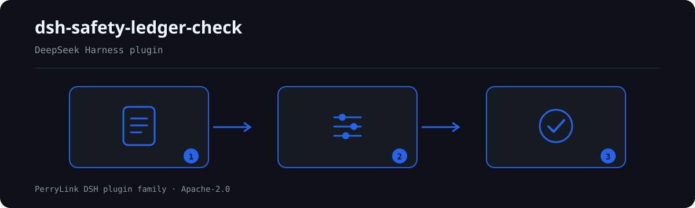

# dsh-safety-ledger-check — Safety ledger check

[English](README.md) · [简体中文](README-zh.md) · [Español](README-es.md) · [Português](README-pt.md) · [हिन्दी](README-hi.md)

<!-- topblock:v1 -->
> **What it is** — Checks a construction safety qualification ledger for induction training, training records, special-operation certificates, validity and trade matching.
> **Who it is for** — construction safety staff; no command line required.
> **What you give it** — the source material the check works on (a table, register or document); the original is never modified. Excel can be converted to JSON/YAML first, in chat if the platform supports it.
> **What it does not do** — no compliance verdict, no liability finding, no replacement for the reviewer; differences only.
> **How to start** — search "Safety Compliance Suite" in WorkBuddy / Coze (this check is one part of it; availability as listed); or:
> `dsh plugin --profile <name> add dsh-safety-ledger-check`
<!-- /topblock:v1 -->

[](https://dshfind.com/en/plugins/PerryLink/dsh-safety-ledger-check?ref=badge)

`dsh-safety-ledger-check` checks a site safety-qualification ledger: whether the training hours reach the statutory floor, whether the training record carries the four elements the regulation requires, and whether special-operation certificates are present and still valid when the person worked.

The pack follows 住建部令第60号 (2025-12-17 公布, **2026-06-01 施行**), which repealed 建质〔2008〕75号 in its 第四十五条. Rules quoting 75号 are therefore stale, and this pack quotes none of them.

## Install

```sh
dsh plugin --profile <name> add dsh-safety-ledger-check
dsh --profile <name> --dump-config | grep 'dsh-safety-ledger-check'
```

## What it looks like



*Workflow overview: document → rule pack → findings.*

**Boundary:** this checks the ledger, not the site. It does not verify that a certificate is genuine — that needs the national quality-and-safety supervision platform — and it does not decide whether a trade falls inside the special-operation catalogue, which is published separately under 60号令第二条. A blank cell is reported as "the ledger does not record it", never as "it did not happen".

## What it answers

- Do new workers reach the 24-hour pre-job training floor, and managers the 32-hour one?
- Does each training record carry time, content, attendee and assessment result?
- Do special-operation workers have a certificate number recorded?
- Is the certificate still valid on the date the person worked?
- Did a first-time certificate holder wait out the six-month internship before working alone?

## Standards it follows

Quotations are verbatim from 中国政府网:

- 《生产经营单位安全培训规定》(令第3号) 第九条 (32/12 学时), 第十二条 (三级教育), 第十三条 (24 学时), 第二十二条 (档案四要素).
- 《建筑施工特种作业人员管理规定》(住建部令第60号) 第三条, 第十四条 (3 年有效期), 第二十条 (按证载工种作业), 第二十二条 (六个月实习).

One rule is deliberately capped at `warn`: 令第3号 第十二条 says 「加工、制造业等生产单位」, and does not name construction enterprises. The three-level induction on a building site comes from industry rules and local detail, so the pack quotes the article as it is and marks it `derived-from-principle` rather than inventing a construction-specific citation.

## Compatibility

| Surface | Status |
|---|---|
| Harness | peer range `>=0.1.2-rc.1 <0.2.0 \|\| >=0.2.0-0 <0.3.0` |
| Node | `^22.19.0 || >=24.0.0` |
| Platforms | all (pure ESM; no native code, no network, no model call) |

## What it does

Ten rules over one flat ledger — one row per person per event. `dateGap` compares two dates with a required minimum gap, so "the certificate was still valid when the person worked" is expressed as 「有效期至 − 作业日期 ≥ 1 天」.

**One rule is not implemented, and the pack says why.** 60号令第二十条 makes 证书工种 ≠ 实际工种 equivalent to working without a certificate, penalised up to ¥100,000. The engine has no exact text-equality kind; the nearest, `sharedTerms`, compares bigrams, so 「塔式起重机司机」 and 「塔式起重机信号工」 would compare as the same trade. A false negative on a rule of that weight is worse than not checking it, so SL-009 is listed under `notImplemented` with the reason.

## Configuration

| Key | Default | Meaning |
|---|---|---|
| `rulesFile` | `rules/safety-ledger-check.yaml` | 规则库路径 |

## Material format

One row per person per training record or certificate:

| Column | Meaning |
|---|---|
| `姓名` | Person |
| `学时` / `管理岗学时` | Pre-job hours / manager hours |
| `培训内容` / `考核结果` / `培训日期` | The record's four elements |
| `证书编号` / `证书工种` / `实操工种` | Certificate identity |
| `发证日期` / `证书有效期至` | Validity window |
| `作业日期` / `独立作业日期` | When the person worked, and when alone |

Aliases are declared in `src/model.ts`.

## Rule sources

Quotations live in `rules/evidence/clauses.md` and in the pack; `check:citations` verifies each appears verbatim.

Known limits: certificates are not verified against the national platform, the special-operation catalogue is not embedded, and only one of the ten ledgers is covered — the other nine are listed in the pack under `ledger.notCovered` and in the report.

## Troubleshooting

- **The plugin installs but the tool never appears**: check that `main` resolves to `lib/index.mjs` and that `pnpm run build` produced it.
- **`dsh plugin add` rejects the package**: the peer range covers `0.1.x` and `0.2.x`; outside it, grant an explicit exemption.
- **A rule did not run**: read the `skipped` array.

## Development

```sh
pnpm install
pnpm run typecheck
pnpm test
pnpm run build
node ../scripts/sync-shared.mjs dsh-safety-ledger-check
```

## PerryLink DSH Plugin Family

Full family index: [choose a checker by material](https://perrylink.github.io/zh/checkers/choose/) and [all plugins](https://github.com/PerryLink). This repository is one of them.

## License

[Apache License 2.0](LICENSE) © 2026 dsh-safety-ledger-check contributors.
