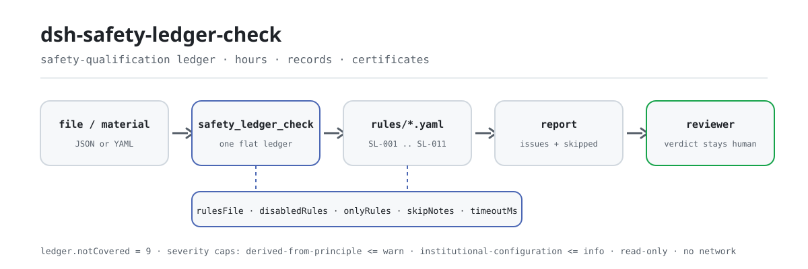

<div align="center">

<picture>
  <source media="(prefers-color-scheme: dark)" srcset="docs/assets/dsh-safety-ledger-check-flow-dark.svg">
  
</picture>

# dsh-safety-ledger-check

**把施工安全资格台账逐行对到条款上，拿到「哪一行、缺什么、依据哪一条」的清单——结论留给审核人。**

面向 DeepSeek Harness 的台账核对插件：一份扁平台账（一人一事件一行）套一份版本化规则库，核对岗前学时、培训档案四要素、特种作业证书与有效期、六个月实习期；只列材料内部能逐条指认的差异，不判合规、不认定责任。

[安装](#三步上手) · [配置](#配置) · [FAQ](#faq) · [简体中文](README.md) · [English](README.en.md) · [Español](README.es.md) · [Português](README.pt.md) · [हिन्दी](README.hi.md)

[](LICENSE)
[](#兼容性)
[](https://www.npmjs.com/package/dsh-safety-ledger-check)
[](https://github.com/PerryLink/dsh-safety-ledger-check/actions/workflows/ci.yml)
[](#兼容性)

[](https://github.com/PerryLink/dsh-safety-ledger-check/stargazers)
[](https://www.npmjs.com/package/dsh-safety-ledger-check)
[](https://dshfind.com/plugins/PerryLink/dsh-safety-ledger-check?ref=badge)
[](https://securityscorecards.dev/viewer/?uri=github.com/PerryLink/dsh-safety-ledger-check)

```sh
dsh plugin --profile <name> add dsh-safety-ledger-check
```

</div>

<sub>社区插件，与 DeepSeek 官方无关。唯一仓库：<https://github.com/PerryLink/dsh-safety-ledger-check>。</sub>

## 它是什么

`dsh-safety-ledger-check` 注册 `safety_ledger_check` 工具：把台账（JSON 或 YAML）交给它，它按随包的规则库逐条核对，返回 Markdown 差异清单与结构化结果。每条发现都带规则号、行号、字段、依据条款与「建议核对」动作；没能执行的检查单列在 `skipped` 里，并写明原因。

它核对的是**台账**，不是现场：只回答材料内部能逐字指认的差异，不判断台账之外是否真的做过培训，也不认定责任。

- **给谁用**：施工安全员、资料员、监理；不用懂命令行。
- **你交什么**：一份安全教育与资格台账（JSON / YAML；一人一条培训记录或证书一行）。
- **它交什么**：`error` / `warn` / `info` 分级的差异清单 + `skipped` 未执行项 + 固定免责声明。

它回答这些问题：

- 新上岗人员的岗前培训是否达到 24 学时？负责人/安管人员是否达到 32 学时？
- 每条培训记录是否都有时间、内容、参加人员、考核结果？
- 特种作业人员是否登记了证书编号？作业当日证书是否仍在有效期内？
- 首次取证人员是否满 6 个月才独立作业？

**边界：** 核对的是台账，不是现场。不验证证书真伪（那要上全国工程质量安全监管信息平台），也不判断某工种是否属于特种作业范围（工种目录按 60 号令第二条另行规定）。空格报的是「台账没有记录」，不是「没有发生过」。

## 三步上手

1. **安装**（三选一）：

   ```sh
   # git 通道（最新 main；等价于 git+https://github.com/PerryLink/dsh-safety-ledger-check.git）
   dsh plugin --profile <name> add github:PerryLink/dsh-safety-ledger-check
   # npm 通道（已发布版本）
   dsh plugin --profile <name> add dsh-safety-ledger-check
   # tarball 通道：本仓库 pnpm pack 后
   dsh plugin --profile <name> add ./dsh-safety-ledger-check-<version>.tgz
   ```

   `main` 指向 `lib/index.mjs`，仓库不提交构建产物——安装后或本地试跑前先 `pnpm install && pnpm run build`。

2. **最小配置**（默认即可用；bundle 行不带 `config` 时全部走默认值，规则库指向随包的 `rules/safety-ledger-check.yaml`）：

   ```yaml
   - insert:
       - id: dsh-safety-ledger-check
         name: dsh-safety-ledger-check
   ```

3. **验证已生效**：先看 profile 里有没有这一行，再跑仓内自带样例：

   ```sh
   dsh --profile <name> --dump-config | grep 'dsh-safety-ledger-check'
   pnpm install && pnpm run build
   node samples/quickstart/run.mjs
   # safety_ledger_check: 1 issue(s) — error 1, warn 0, info 0
   # skipped: 0
   ```

   样例输入是 `samples/quickstart/input/SL-001-unsafe.yaml`（岗前 16 学时，低于 24），期望输出在 `samples/quickstart/expected/result.json`。

**卸载**：`dsh plugin --profile <name> remove dsh-safety-ledger-check`（或从 profile patch 删掉该行）。

## 核心能力

`dsh-safety-ledger-check` 把「规则」与「代码」分开：规则库是数据，换掉 `rules/*.yaml` 就换掉整套检查，不动一行 TypeScript。

- **10 条规则一包带走** —— `rules/safety-ledger-check.yaml`（版本 `2026.1`，基准日 `2026-10-24`）覆盖学时、档案四要素、证书编号、有效期、六个月实习期与模板占位符；`dateGap` 用两个日期的最小间隔表达「有效期至 − 作业日期 ≥ 1 天」。
- **只核字段自洽，不核事实** —— 数值只比大小、日期只比先后、字段只比有无；不判断培训内容是否覆盖大纲，不判断证书真伪。
- **一条规则故意不做** —— 60 号令第二十条要求「按证书载明的工种作业」，`certTrade` 与 `workTrade` 只要不相等就视同无证上岗。现有引擎没有精确文本相等类型，最近的 `sharedTerms` 按二元组比相似度，会把「塔式起重机司机」与「塔式起重机信号工」判成同一工种；对一条罚 10 万以下的规则，这种假阴性比不检查更危险。故 SL-009 列在 `notImplemented` 并写明原因。
- **没执行的检查会说** —— 材料缺列、规则被 `disabledRules` 停用、`onlyRules` 未选中，都会进 `skipped` 并带原因；空结果不等于「没问题」。
- **严重级跟着证据走** —— `direct` 可到 `error`；`derived-from-principle` 最高 `warn`（SL-005）；`institutional-configuration` 最高 `info`（SL-011）；有测试断言。
- **只读、无网络、不调用模型** —— 纯 ESM，只读你给它的材料并做内存计算；工具参数为 `file` / `material` / `rulesFile` / `only`。

### 示例

自带样例的期望输出（`samples/quickstart/expected/result.json`）：

```json
{
  "tool": "safety_ledger_check",
  "issueCount": 1,
  "summary": { "error": 1, "warn": 0, "info": 0 },
  "skippedCount": 0
}
```

*Observed from `samples/quickstart/expected/result.json`；运行 `node samples/quickstart/run.mjs` 复现*

单条差异的渲染形态（`src/view.ts`）：

```text
- `SL-001` [第1行 · 字段 trainingHours] 第 1 行「trainingHours」为 16，小于配置下限 24
  - 依据：「trainingHours」应不小于 24
  - 条款：《生产经营单位安全培训规定》（国家安全生产监督管理总局令第3号） 第十三条：「生产经营单位新上岗的从业人员，岗前安全培训时间不得少于24学时。」
  - 建议核对：核对岗前培训学时；本条只比较数值，不判断培训内容是否覆盖大纲
```

*Observed from `src/view.ts:42-45`、`src/shared/rows.ts:574-580`、`rules/safety-ledger-check.yaml:49-64`*

## 依据的标准

引文逐字取自中国政府网（2026-10-24 取回）：

- 《生产经营单位安全培训规定》（国家安全生产监督管理总局令第3号）第九条（32/12 学时）、第十二条（三级教育）、第十三条（24 学时）、第二十二条（档案四要素）。
- 《建筑施工特种作业人员管理规定》（住房和城乡建设部令第60号）第三条、第十四条（3 年有效期）、第二十条（按证载工种作业）、第二十二条（六个月实习）。
- 本机构资料归档办法（本机构配置）：SL-011 的模板占位符要求，不属于法规条款。

**时效：** 60 号令 2025-12-17 公布、**2026-06-01 施行**，其第四十五条明确废止建质〔2008〕75号。凡引用 75 号的规则都已过期，本包一条都不引；核对 2026-06-01 之前的台账时，应换用旧规则库。

有一条**故意只到 warn**：令第3号第十二条写的是「加工、制造业等生产单位」，并未点名建筑施工企业。建筑工地的三级教育来自行业规定与地方细则，所以本包照原文引用，标 `derived-from-principle`，不伪造一条针对建筑业的引文。

## 配置

`src/config.ts` 的 Schemastery `Config` 字段（可从 cordis.yml 覆盖）。按 id 覆盖会替换整行——请重述所有需要的键。

| 键 | 类型 | 默认值 | 说明 |
|---|---|---|---|
| `rulesFile` | string | `rules/safety-ledger-check.yaml` | 规则库文件路径，相对插件包根目录；也可传绝对路径；替换它即切换规则集版本 |
| `disabledRules` | string[] | `[]` | 要停用的规则 id 列表；停用的规则会出现在报告的 `skipped` 中 |
| `onlyRules` | string[] | `[]` | 只执行这些规则 id；留空表示执行全部规则 |
| `skipNotes` | string | `''` | 附加到每条 `skipped` 说明后的备注，例如标注本机构实施细则 |
| `timeoutMs` | number | `120000` | 工具协作式超时预算（毫秒） |

profile patch 覆盖示例：

```yaml
- insert:
    - id: dsh-safety-ledger-check
      name: dsh-safety-ledger-check
      config:
        disabledRules: [SL-011]
        skipNotes: 按本机构 2026 版归档细则执行
        timeoutMs: 180000
```

工具调用时还可以用 `file` / `material` 二选一提供材料，用 `rulesFile` 单次覆盖规则库，用 `only` 单次限定规则；这些参数不写进 profile。

## 材料格式

一份扁平台账：一人一条培训记录或证书一行。JSON 或 YAML 均可，顶层用 `rows`（也认 `items` / `records` / `台账` / `人员`）；表头可带 `project` / `unit` / `period` / `checkedAt` / `basis`。

| 列 | 含义 |
|---|---|
| `姓名` | 人员（也认 `人员姓名` / `作业人员` / `personName`） |
| `工种` | 作业工种（`trade`） |
| `教育级别` | 三级教育级别（`公司` / `项目` / `班组`） |
| `学时` / `管理岗学时` | 岗前培训学时 / 负责人、安管人员学时 |
| `培训日期` / `培训内容` / `考核结果` | 培训档案四要素中的三项（参加人员由行本身表达） |
| `证书编号` | 特种作业证书编号 |
| `证书工种` / `实际工种` | 证书载明工种 / 实际作业工种 |
| `发证日期` / `证书有效期至` | 有效期窗口 |
| `作业日期` / `独立作业日期` | 作业日期，以及首次独立作业日期 |
| `备注` | 备注（`remark`） |

列名别名在 `src/model.ts` 的 `COLUMNS` 里声明。材料没有携带某列时，依赖该列的规则会进入 `skipped`，不会静默通过。

## 规则来源

规则数据在 `rules/safety-ledger-check.yaml`，与代码分离：每条规则带 `document` / `number` / `clause` / `excerpt` / `kind` / `source`，`excerpt` 必须是逐字引文。逐字引文同时收录在 `rules/evidence/clauses.md`，`check:citations`（`node scripts/check-citations.mjs`）逐条核对：新出现的不可溯源片段会让门禁失败。

已知限制：证书不在全国工程质量安全监管信息平台核验；特种作业工种目录没有内嵌；十本台账只覆盖「安全教育与资格台账」一本，其余九本在规则库的 `ledger.notCovered` 与报告的提示里逐本列出。

## FAQ

<details>
<summary>台账会被上传吗？数据存在哪？</summary>

不会。`dsh-safety-ledger-check` 是本地核对器：只读你交给工具的 `file` / `material`，不发网络请求、不带遥测与分析，也不在工具结果和 DSH 宿主的会话/日志存储之外写数据；宿主的存储与保留策略由宿主控制，本包不另存第二份（见 [PRIVACY.md](PRIVACY.md)）。

</details>

<details>
<summary>空结果是不是说明台账没问题？</summary>

不是。报告同时给出 `skipped`：材料缺列、规则被 `disabledRules` 停用、`onlyRules` 未选中，都会逐条写明原因。空格只报「台账没有记录」，不报「没有发生过」；全部规则都执行且 `issues` 为空，才表示这次声明的检查项没有发现可指认的差异。

</details>

<details>
<summary>为什么不查证书真伪，也不查证书工种与实际工种是否一致？</summary>

证书真伪要上全国工程质量安全监管信息平台核验，本插件只读台账，不访问外部系统。工种一致性（SL-009）是故意不做的：60 号令第二十条把「证书工种 ≠ 实际工种」视同无证上岗，而引擎没有精确文本相等类型，近似比对会把「塔式起重机司机」与「塔式起重机信号工」判成同一工种——这种假阴性比不检查更危险，所以规则库里列在 `notImplemented` 并写明原因。

</details>

<details>
<summary>会和别的 DSH 插件抢工具名、服务键或 slot 吗？</summary>

不会。它只 `inject: ['tools']` 并注册一个工具 `safety_ledger_check`，不提供服务键、不注册客户端 slot、不注册 `webServer` 前缀、不监听会话事件、不改全局对象；bundle patch 只 `insert` 自己那一行。详见「与其他 DSH 插件的互操作性」。

</details>

<details>
<summary>性能开销多大？</summary>

一次核对 = 读一份 JSON/YAML + 在内存里逐行套规则，没有网络请求、没有模型调用。开销与行数和规则数成正比；`timeoutMs`（默认 120 秒）是工具的协作式超时预算，不是硬性中断。

</details>

## 排障

- **插件装上了但工具不出现**：确认 `main` 解析到 `lib/index.mjs`，且 `pnpm run build` 已产出该文件。
- **`dsh plugin add` 以不兼容为由拒绝安装**：本包 `engines.dsh` 为 `>=0.2.1-0 <0.3.0`；运行时在其之外时，请显式豁免或在 profile 里固定宿主版本。
- **某条规则没有执行**：读工具结果里的 `skipped` 数组；材料缺列、规则被停用或未选中都会在那里写明原因。

## 安全边界与已知限制

- **核对台账，不核对现场。** 只回答材料内部能逐条指认的差异；台账之外是否真的做过培训，不在核对范围。
- **不验证证书真伪。** 那需要全国工程质量安全监管信息平台；本插件只读你给的台账，不访问外部系统。
- **不判断特种作业工种目录。** 某工种是否属于特种作业范围，按 60 号令第二条另行规定，本包不内嵌该目录。
- **空格 ≠ 没发生。** 空白单元格报的是「台账没有记录」，不是「没有发生过」；缺记录只说明台账无法证明，不等于现场没做。
- **不判合规、不认定责任、不替代审核人。** 渲染层有措辞守卫（`src/shared/wording.ts`），报告固定携带免责声明；结论性判断留给审核人。
- **严重级有上限。** `derived-from-principle` 最高 `warn`，`institutional-configuration` 最高 `info`，有测试断言。
- **只读。** 不发网络请求、不存凭据、不调用模型、不写文件；除工具结果与宿主自己的会话/日志外不落任何副本（见 [PRIVACY.md](PRIVACY.md) 与 [SECURITY.md](SECURITY.md)）。
- **一条规则未实现。** SL-009（按证书载明的工种作业）列在规则库的 `notImplemented` 中：引擎没有两个文本字段精确相等的检查类型，近似比对会产生高危假阴性。
- **只覆盖十本台账中的一本。** 其余九本在规则库的 `ledger.notCovered` 与报告里逐本列出「未覆盖」。
- **规则有时效。** 60 号令 2026-06-01 施行并废止建质〔2008〕75号；核对更早的台账应换用旧规则库。
- **报告渲染目前是中文。** `src/view.ts` 的 Markdown 文案为固定中文；结构化字段（`summary` / `issueCount` / `skippedCount` / `reportJson`）与语言无关。

### 与其他 DSH 插件的互操作性

本插件只做一件事，且不占用共享资源：

- **只注册一个工具** —— `safety_ledger_check`，只 `inject: ['tools']`；工具结果只回给调用方。
- **无服务键冲突** —— 不提供任何服务键。
- **无 slot / 路由冲突** —— 不注册客户端 slot key，不注册任何 `webServer` 前缀。
- **无事件冲突** —— 不监听会话事件，不参与事件链。
- **无 patch 层冲突** —— `cordis.patch.yml` 只 `insert` 自己那一行，从不覆写内置行的 `config`。
- **无全局改写** —— 不改原型、不改写 `process.env`、不替换全局 fetch dispatcher。

## 兼容性

| 项目 | 状态 |
|---|---|
| Harness | `engines.dsh`：`>=0.2.1-0 <0.3.0`；peer `@deepseek-ai/dsh-tools`：`>=0.1.2-rc.1 <0.2.0 \|\| >=0.2.0-0 <0.3.0` |
| Node | `^22.19.0 \|\| >=24.0.0` |
| 平台 | 全平台（纯 ESM；无原生代码、无联网、不调用模型） |
| 材料 | JSON 或 YAML，UTF-8；一人一条培训记录或证书一行 |

## 生态与质量

- [dshfind 插件页](https://dshfind.com/plugins/PerryLink/dsh-safety-ledger-check)（安装量与排名）
- [OpenSSF Scorecard 报告](https://securityscorecards.dev/viewer/?uri=github.com/PerryLink/dsh-safety-ledger-check)（由 [.github/workflows/scorecard.yml](.github/workflows/scorecard.yml) 驱动）
- [生态实测知识库](https://perrylink.github.io/dsh-plugin-guide/)：插件开发指南 · 选型实测数据 · 维护取舍判据
- 完整家族索引：[按材料选核查器](https://perrylink.github.io/zh/checkers/choose/) · [全部插件](https://github.com/PerryLink)

## 开发

```sh
pnpm install                                        # node ^22.19 || >=24
pnpm run typecheck                                  # tsc --noEmit
pnpm test                                           # vitest：33 个测试
pnpm run build                                      # tsdown -> lib/index.mjs + lib/index.d.mts
pnpm run verify:self-contained                      # 依赖 spec 均来自 registry
pnpm run check:lockfile                             # lockfile 漂移检查
pnpm run check:readmes                              # 五语 README 一致性
pnpm run check:citations                            # 规则包引文基线
node ../scripts/sync-shared.mjs dsh-safety-ledger-check   # 从 ../_shared 刷新 src/shared
pnpm pack                                           # 发布 tarball
```

本地样例试跑（需先 `pnpm run build` 产出 `lib/`）：

```sh
node samples/quickstart/run.mjs
# safety_ledger_check: 1 issue(s) — error 1, warn 0, info 0
# skipped: 0
```

目录布局：

| 路径 | 作用 |
|---|---|
| `src/index.ts` | 函数插件契约：注册 `safety_ledger_check`，解析随包规则库 |
| `src/config.ts` | Schemastery 配置（`rulesFile` / `disabledRules` / `onlyRules` / `skipNotes` / `timeoutMs`） |
| `src/model.ts` | 台账列定义与别名、材料解析、`runCheck` 入口 |
| `src/view.ts` | 模型可见的报告投影（Markdown + `reportJson`） |
| `src/shared/` | 共享套件（规则库读取、表格引擎、日期运算、措辞守卫） |
| `rules/` | 规则库与 `evidence/` 条款核验记录 |
| `samples/quickstart/` | 自带样例、期望输出与试跑脚本 |
| `tests/` | vitest：每条规则配套合规/违规夹具 |
| `scripts/` | 引文、lockfile、自包含与五语 README 门禁 |

README 配图由 [`scripts/gen-readme-assets.py`](scripts/gen-readme-assets.py) 程序化生成（Python + Pillow），可重复执行；旧的单版流程图、hero 与演示图保留在 `docs/assets/` 供外链使用，README 只引用新生成的深浅双版。

Topics：`deepseek-harness`, `dsh`, `dsh-plugin`, `cordis`, `safety`, `ledger`, `training`, `certificate`

## 家族与致谢

本项目是 [PerryLink](https://github.com/PerryLink) 维护的 DeepSeek Harness 插件家族成员（全部 Apache-2.0）。完整家族索引见[按材料选核查器](https://perrylink.github.io/zh/checkers/choose/)与[全部插件](https://github.com/PerryLink)。如果这个插件帮到了你，**给个 star**——它不解锁任何功能，但会让下一个人更容易找到它。

- [@PerryLink](https://github.com/PerryLink) —— 创建者与维护者：规则库（SL-001..SL-011）、`safety_ledger_check` 工具、引文核验记录与五语文档。

<details>
<summary>展开全部插件</summary>

| 插件 | 状态 |
|---|---|
| **[dsh-aqua-input-check](https://github.com/PerryLink/dsh-aqua-input-check)** |  |
| **[dsh-archive-check](https://github.com/PerryLink/dsh-archive-check)** |  |
| **[dsh-auto-review](https://github.com/PerryLink/dsh-auto-review)** |  |
| **[dsh-autotier](https://github.com/PerryLink/dsh-autotier)** | 🧊 已冻结 — 见仓库 README |
| **[dsh-bid-ca-precheck](https://github.com/PerryLink/dsh-bid-ca-precheck)** |  |
| **[dsh-bid-qual-check](https://github.com/PerryLink/dsh-bid-qual-check)** |  |
| **[dsh-cert-mcp](https://github.com/PerryLink/dsh-cert-mcp)** | 🧊 已冻结 — 见仓库 README |
| **[dsh-checkpoint-rewind](https://github.com/PerryLink/dsh-checkpoint-rewind)** |  |
| **[dsh-click](https://github.com/PerryLink/dsh-click)** |  |
| **[dsh-composer-history](https://github.com/PerryLink/dsh-composer-history)** |  |
| **[dsh-contract-stance](https://github.com/PerryLink/dsh-contract-stance)** |  |
| **[dsh-customs-doc-check](https://github.com/PerryLink/dsh-customs-doc-check)** |  |
| **[dsh-data-quality](https://github.com/PerryLink/dsh-data-quality)** | 🧊 已冻结 — 见仓库 README |
| **[dsh-demurrage-ledger](https://github.com/PerryLink/dsh-demurrage-ledger)** |  |
| **[dsh-doublecheck](https://github.com/PerryLink/dsh-doublecheck)** |  |
| **[dsh-drill-script-check](https://github.com/PerryLink/dsh-drill-script-check)** |  |
| **[dsh-eia-guide-check](https://github.com/PerryLink/dsh-eia-guide-check)** |  |
| **[dsh-emergency-plan](https://github.com/PerryLink/dsh-emergency-plan)** |  |
| **[dsh-essay-rubric-check](https://github.com/PerryLink/dsh-essay-rubric-check)** |  |
| **[dsh-evidence-check](https://github.com/PerryLink/dsh-evidence-check)** |  |
| **[dsh-export-ctl-check](https://github.com/PerryLink/dsh-export-ctl-check)** |  |
| **[dsh-fast](https://github.com/PerryLink/dsh-fast)** |  |
| **[dsh-fmea-table-check](https://github.com/PerryLink/dsh-fmea-table-check)** |  |
| **[dsh-forecast-penalty](https://github.com/PerryLink/dsh-forecast-penalty)** |  |
| **[dsh-fund-research](https://github.com/PerryLink/dsh-fund-research)** |  |
| **[dsh-github](https://github.com/PerryLink/dsh-github)** |  |
| **[dsh-gongwen-flow-check](https://github.com/PerryLink/dsh-gongwen-flow-check)** |  |
| **[dsh-gongwen-word-check](https://github.com/PerryLink/dsh-gongwen-word-check)** |  |
| **[dsh-guard-plan-qc](https://github.com/PerryLink/dsh-guard-plan-qc)** |  |
| **[dsh-hazchem-check](https://github.com/PerryLink/dsh-hazchem-check)** |  |
| **[dsh-hazplan-check](https://github.com/PerryLink/dsh-hazplan-check)** |  |
| **[dsh-hidden-risk-map](https://github.com/PerryLink/dsh-hidden-risk-map)** |  |
| **[dsh-hs-classify](https://github.com/PerryLink/dsh-hs-classify)** |  |
| **[dsh-icd-rule-check](https://github.com/PerryLink/dsh-icd-rule-check)** |  |
| **[dsh-industry-research](https://github.com/PerryLink/dsh-industry-research)** |  |
| **[dsh-lawcite-adapter](https://github.com/PerryLink/dsh-lawcite-adapter)** |  |
| **[dsh-laya](https://github.com/PerryLink/dsh-laya)** |  |
| **[dsh-lc-doc-check](https://github.com/PerryLink/dsh-lc-doc-check)** |  |
| **[dsh-learning-gap-check](https://github.com/PerryLink/dsh-learning-gap-check)** |  |
| **[dsh-library](https://github.com/PerryLink/dsh-library)** |  |
| **[dsh-local-ai](https://github.com/PerryLink/dsh-local-ai)** |  |
| **[dsh-lsp-actions](https://github.com/PerryLink/dsh-lsp-actions)** |  |
| **[dsh-mask](https://github.com/PerryLink/dsh-mask)** |  |
| **[dsh-mcp-panel](https://github.com/PerryLink/dsh-mcp-panel)** |  |
| **[dsh-medrec-qc](https://github.com/PerryLink/dsh-medrec-qc)** |  |
| **[dsh-memento](https://github.com/PerryLink/dsh-memento)** | 🧊 已冻结 — 见仓库 README |
| **[dsh-nsfc-form-check](https://github.com/PerryLink/dsh-nsfc-form-check)** |  |
| **[dsh-nurse-record-check](https://github.com/PerryLink/dsh-nurse-record-check)** |  |
| **[dsh-observe](https://github.com/PerryLink/dsh-observe)** |  |
| **[dsh-origin-rvc-check](https://github.com/PerryLink/dsh-origin-rvc-check)** |  |
| **[dsh-ota-review-check](https://github.com/PerryLink/dsh-ota-review-check)** |  |
| **[dsh-output-styles](https://github.com/PerryLink/dsh-output-styles)** |  |
| **[dsh-paper-doc-adapter](https://github.com/PerryLink/dsh-paper-doc-adapter)** |  |
| **[dsh-permission-rules](https://github.com/PerryLink/dsh-permission-rules)** |  |
| **[dsh-permit-report-check](https://github.com/PerryLink/dsh-permit-report-check)** |  |
| **[dsh-pipeline-check](https://github.com/PerryLink/dsh-pipeline-check)** |  |
| **[dsh-pleading-draft](https://github.com/PerryLink/dsh-pleading-draft)** |  |
| **[dsh-plugin-doctor](https://github.com/PerryLink/dsh-plugin-doctor)** | 🚫 已退役（仓库已归档） |
| **[dsh-plugin-guide](https://github.com/PerryLink/dsh-plugin-guide)** |  |
| **[dsh-plugin-kit](https://github.com/PerryLink/dsh-plugin-kit)** | 🚫 已退役（仓库已归档） |
| **[dsh-plugin-upgrade](https://github.com/PerryLink/dsh-plugin-upgrade)** | 🚫 已退役（仓库已归档） |
| **[dsh-policy-brief-draft](https://github.com/PerryLink/dsh-policy-brief-draft)** |  |
| **[dsh-power-loss-split](https://github.com/PerryLink/dsh-power-loss-split)** |  |
| **[dsh-power-ticket-check](https://github.com/PerryLink/dsh-power-ticket-check)** |  |
| **[dsh-ppap-check](https://github.com/PerryLink/dsh-ppap-check)** |  |
| **[dsh-protest-deadline](https://github.com/PerryLink/dsh-protest-deadline)** |  |
| **[dsh-railway-window](https://github.com/PerryLink/dsh-railway-window)** |  |
| **[dsh-repair-order-qc](https://github.com/PerryLink/dsh-repair-order-qc)** |  |
| **[dsh-research-report](https://github.com/PerryLink/dsh-research-report)** |  |
| **[dsh-review-reply-check](https://github.com/PerryLink/dsh-review-reply-check)** |  |
| **[dsh-rulefile-check](https://github.com/PerryLink/dsh-rulefile-check)** |  |
| **[dsh-safety-brief-check](https://github.com/PerryLink/dsh-safety-brief-check)** |  |
| **[dsh-score](https://github.com/PerryLink/dsh-score)** | 🧊 已冻结 — 见仓库 README |
| **[dsh-session-sync](https://github.com/PerryLink/dsh-session-sync)** |  |
| **[dsh-site-log-check](https://github.com/PerryLink/dsh-site-log-check)** |  |
| **[dsh-skill-pack-security](https://github.com/PerryLink/dsh-skill-pack-security)** |  |
| **[dsh-soe-decision-check](https://github.com/PerryLink/dsh-soe-decision-check)** |  |
| **[dsh-soilwater-check](https://github.com/PerryLink/dsh-soilwater-check)** |  |
| **[dsh-sop-sync-check](https://github.com/PerryLink/dsh-sop-sync-check)** |  |
| **[dsh-spc-gbt-adapter](https://github.com/PerryLink/dsh-spc-gbt-adapter)** |  |
| **[dsh-talk](https://github.com/PerryLink/dsh-talk)** |  |
| **[dsh-tender-extract](https://github.com/PerryLink/dsh-tender-extract)** |  |
| **[dsh-tender-matrix](https://github.com/PerryLink/dsh-tender-matrix)** |  |
| **[dsh-test-drive](https://github.com/PerryLink/dsh-test-drive)** |  |
| **[dsh-ticktick](https://github.com/PerryLink/dsh-ticktick)** | 🚫 已退役（仓库已归档） |
| **[dsh-translate](https://github.com/PerryLink/dsh-translate)** |  |
| **[dsh-warranty-calc](https://github.com/PerryLink/dsh-warranty-calc)** |  |
| **[dsh-budget](https://github.com/PerryLink/dsh-budget)** | 🧊 已冻结 — 见仓库 README |
| **[dsh-claude-move](https://github.com/PerryLink/dsh-claude-move)** | 🧊 已冻结 — 见仓库 README |
| **[dsh-defend](https://github.com/PerryLink/dsh-defend)** | 🧊 已冻结 — 见仓库 README |
| **[dsh-draw](https://github.com/PerryLink/dsh-draw)** | 🧊 已冻结 — 见仓库 README |
| **[dsh-reach](https://github.com/PerryLink/dsh-reach)** | 🧊 已冻结 — 见仓库 README |
| **[dsh-background-agents](https://github.com/PerryLink/dsh-background-agents)** | 🚫 已退役（仓库已归档） |
| **[dsh-session-pin](https://github.com/PerryLink/dsh-session-pin)** | 🚫 已退役（仓库已归档） |
| **[dsh-team-rooms](https://github.com/PerryLink/dsh-team-rooms)** | 🚫 已退役（仓库已归档） |

</details>

## License

[LICENSE](LICENSE)（Apache License 2.0）© 2026 dsh-safety-ledger-check contributors

<p align="center"><sub>Apache-2.0 · 社区插件，与 DeepSeek 无关。</sub></p>
