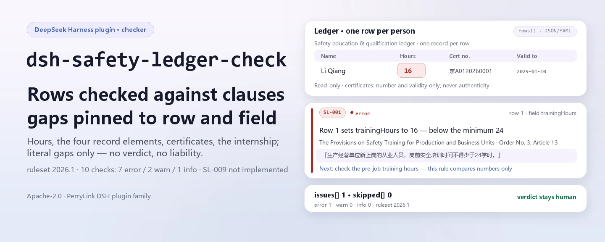

<div align="center">

<picture>
  <source media="(prefers-color-scheme: dark)" srcset="docs/assets/dsh-safety-ledger-check-hero-en-dark.webp">
  
</picture>

# dsh-safety-ledger-check

**Confira o registro de qualificação em segurança de uma obra linha a linha contra as cláusulas e receba a lista de qual linha, o que falta e qual cláusula exige — a conclusão fica com o revisor.**

Um plugin de conferência de registros para DeepSeek Harness: um registro plano (uma linha por pessoa por evento) é comparado com um pacote de regras versionado que verifica horas de treinamento prévio, os quatro elementos do registro de treinamento, certificados de operação especial e sua validade, e os seis meses de estágio — listando apenas diferenças apontáveis dentro do material, sem parecer de conformidade e sem atribuição de responsabilidade.

[Instalar](#instalação-em-três-passos) · [Configuração](#configuração) · [FAQ](#faq) · [简体中文](README.md) · [English](README.en.md) · [Español](README.es.md) · [Português](README.pt.md) · [हिन्दी](README.hi.md)

[](LICENSE)
[](#compatibilidade)
[](https://www.npmjs.com/package/dsh-safety-ledger-check)
[](https://github.com/PerryLink/dsh-safety-ledger-check/actions/workflows/ci.yml)
[](#compatibilidade)

[](https://github.com/PerryLink/dsh-safety-ledger-check/stargazers)
[](https://www.npmjs.com/package/dsh-safety-ledger-check)
[](https://dshfind.com/plugins/PerryLink/dsh-safety-ledger-check?ref=badge)
[](https://securityscorecards.dev/viewer/?uri=github.com/PerryLink/dsh-safety-ledger-check)

```sh
dsh plugin --profile <name> add dsh-safety-ledger-check
```

</div>

<sub>Plugin da comunidade, não afiliado ao DeepSeek. Repositório canônico: <https://github.com/PerryLink/dsh-safety-ledger-check>.</sub>

## O que é

`dsh-safety-ledger-check` registra a ferramenta `safety_ledger_check`: você entrega o registro (JSON ou YAML) e ela aplica o pacote de regras incluído linha a linha, devolvendo uma lista de diferenças em Markdown e um resultado estruturado. Cada achado traz id de regra, número da linha, campo, cláusula de base e uma ação «conferir»; toda verificação que não pôde rodar aparece em `skipped` com o motivo.

Ela confere o **registro**, não a obra: responde apenas ao que o material consegue comprovar célula a célula, não julga se fora do registro o treinamento realmente aconteceu e não atribui responsabilidade.

- **Para quem**: responsáveis de segurança, documentalistas e supervisores de obra; não é preciso usar a linha de comando.
- **O que você entrega**: um registro de treinamento em segurança e qualificação (JSON / YAML; uma linha por registro de treinamento ou certificado e pessoa).
- **O que você recebe**: uma lista de diferenças graduada `error` / `warn` / `info` + as verificações de `skipped` + um aviso fixo.

Ela responde a estas perguntas:

- Os novos trabalhadores alcançam as 24 horas de treinamento prévio e os responsáveis as 32?
- Cada registro de treinamento traz data, conteúdo, participantes e resultado da avaliação?
- Os operadores de operação especial têm número de certificado registrado? O certificado ainda era válido no dia trabalhado?
- Quem obteve o certificado pela primeira vez esperou os seis meses de estágio antes de trabalhar sozinho?

**Limite:** confere o registro, não a obra. Não verifica a autenticidade do certificado — isso exige a plataforma nacional de supervisão de qualidade e segurança — nem decide se um ofício pertence ao catálogo de operações especiais, publicado à parte no artigo 2 da Ordem 60. Uma célula vazia é informada como «o registro não o registra», nunca como «não aconteceu».

<picture>
  <source media="(prefers-color-scheme: dark)" srcset="docs/assets/dsh-safety-ledger-check-flow-v5-dark.svg">
  
</picture>

## Instalação em três passos

1. **Instale** (escolha um canal):

   ```sh
   # canal git (main mais recente; equivale a git+https://github.com/PerryLink/dsh-safety-ledger-check.git)
   dsh plugin --profile <name> add github:PerryLink/dsh-safety-ledger-check
   # canal npm (versões publicadas)
   dsh plugin --profile <name> add dsh-safety-ledger-check
   # canal tarball: pnpm pack neste repo e depois
   dsh plugin --profile <name> add ./dsh-safety-ledger-check-<version>.tgz
   ```

   `main` aponta para `lib/index.mjs`; o repositório não versiona o resultado da compilação, então rode `pnpm install && pnpm run build` após instalar ou antes de um teste local.

2. **Configuração mínima** (os padrões já funcionam; uma linha de bundle sem `config` usa todos os padrões e o pacote de regras incluído em `rules/safety-ledger-check.yaml`):

   ```yaml
   - insert:
       - id: dsh-safety-ledger-check
         name: dsh-safety-ledger-check
   ```

3. **Verifique que monta**: confira a linha no perfil e rode o exemplo incluído:

   ```sh
   dsh --profile <name> --dump-config | grep 'dsh-safety-ledger-check'
   pnpm install && pnpm run build
   node samples/quickstart/run.mjs
   # safety_ledger_check: 1 issue(s) — error 1, warn 0, info 0
   # skipped: 0
   ```

   A entrada do exemplo é `samples/quickstart/input/SL-001-unsafe.yaml` (16 horas prévias, abaixo de 24); a saída esperada está em `samples/quickstart/expected/result.json`.

**Desinstalar**: `dsh plugin --profile <name> remove dsh-safety-ledger-check` (ou remova a linha do patch do perfil).

## Capacidades principais

`dsh-safety-ledger-check` separa regras e código: o pacote de regras é dado, e substituir `rules/*.yaml` troca todo o conjunto de verificações sem tocar em uma linha de TypeScript.

- **10 regras em um pacote de dados** — `rules/safety-ledger-check.yaml` (versão `2026.1`, data de referência `2026-10-24`) cobre horas de treinamento, os quatro elementos do registro, número de certificado, validade, os seis meses de estágio e marcadores de modelo; `dateGap` expressa «válido até a data de trabalho» como vencimento menos data de trabalho maior ou igual a um dia.
- **Confere coerência de campos, não fatos** — números só comparam magnitude, datas só comparam ordem, campos só conferem presença; não julga se o conteúdo do treinamento cobre o programa nem se o certificado é autêntico.
- **Uma regra fica de fora de propósito** — o artigo 20 da Ordem 60 exige trabalhar «conforme o ofício certificado», então qualquer divergência entre `certTrade` e `workTrade` equivale a trabalhar sem certificado. O motor não tem um tipo de igualdade textual exata; o mais próximo, `sharedTerms`, compara bigramas e pontuaria «operador de guindaste torre» e «sinaleiro de guindaste torre» como o mesmo ofício. Numa regra com multa de até ¥100.000, esse falso negativo é pior do que não conferir, então SL-009 consta em `notImplemented` com o motivo.
- **As verificações que não rodam avisam** — coluna ausente, regra desativada por `disabledRules` ou excluída por `onlyRules` entram em `skipped` com o motivo; resultado vazio não é «nenhum problema».
- **A gravidade segue a evidência** — `direct` pode chegar a `error`; `derived-from-principle` fica limitado a `warn` (SL-005); `institutional-configuration` a `info` (SL-011); há teste que garante isso.
- **Somente leitura, sem rede, sem modelo** — ESM puro: lê o material que você passa e calcula em memória; os parâmetros da ferramenta são `file` / `material` / `rulesFile` / `only`.

### Exemplo

Saída esperada do exemplo incluído (`samples/quickstart/expected/result.json`):

```json
{
  "tool": "safety_ledger_check",
  "issueCount": 1,
  "summary": { "error": 1, "warn": 0, "info": 0 },
  "skippedCount": 0
}
```

*Observed from `samples/quickstart/expected/result.json`; reproduza com `node samples/quickstart/run.mjs`*

O texto do relatório renderizado hoje é em chinês (strings fixas em `src/view.ts`); os campos estruturados (`summary` / `issueCount` / `skippedCount` / `reportJson`) não dependem do idioma.

## Normas seguidas

As citações são literais do portal do Governo chinês (obtidas em 2026-10-24):

- Normas de treinamento em segurança para unidades produtivas (Ordem n.º 3 da Administração Estatal de Segurança do Trabalho), artigos 9 (32/12 horas), 12 (formação em três níveis), 13 (24 horas) e 22 (os quatro elementos do arquivo).
- Normas de gestão do pessoal de operações especiais na construção (Ordem n.º 60 do Ministério da Habitação e Desenvolvimento Urbano-Rural), artigos 3, 14 (validade de 3 anos), 20 (trabalhar conforme o ofício certificado) e 22 (seis meses de estágio).
- Política de arquivo da própria instituição (configuração institucional): o requisito de marcadores de modelo do SL-011 não é cláusula legal.

**Vigência:** a Ordem 60 foi publicada em 2025-12-17 e **entra em vigor em 2026-06-01**; seu artigo 45 revoga expressamente a Jianzhi [2008] n.º 75. Toda regra que cite a Ordem 75 está obsoleta e este pacote não cita nenhuma; para conferir um registro anterior a 2026-06-01 é preciso usar o pacote de regras antigo.

Uma regra fica **deliberadamente limitada a `warn`**: o artigo 12 da Ordem n.º 3 fala de «unidades produtivas como transformação e manufatura» e não nomeia construtoras. A formação em três níveis no canteiro vem de normas setoriais e detalhes locais, então o pacote cita o artigo como está e o marca `derived-from-principle` em vez de inventar uma citação específica para a construção.

## Configuração

Campos Schemastery `Config` em `src/config.ts` (alteráveis pelo cordis.yml). Uma sobrescrita por id substitui a linha inteira: repita todas as chaves necessárias.

| Chave | Tipo | Padrão | Significado |
|---|---|---|---|
| `rulesFile` | string | `rules/safety-ledger-check.yaml` | Caminho do pacote de regras relativo à raiz do pacote; também aceita caminho absoluto. Substituí-lo troca a versão do conjunto de regras |
| `disabledRules` | string[] | `[]` | Ids de regra a desativar; cada regra desativada aparece em `skipped` |
| `onlyRules` | string[] | `[]` | Rodar só estes ids de regra; vazio significa todas |
| `skipNotes` | string | `''` | Nota anexada a cada motivo de `skipped`, por exemplo para citar uma norma interna |
| `timeoutMs` | number | `120000` | Orçamento cooperativo de timeout da ferramenta, em milissegundos |

Exemplo de sobrescrita no patch do perfil:

```yaml
- insert:
    - id: dsh-safety-ledger-check
      name: dsh-safety-ledger-check
      config:
        disabledRules: [SL-011]
        skipNotes: aplicar a política de arquivo 2026 da instituição
        timeoutMs: 180000
```

Uma chamada da ferramenta também pode passar `file` ou `material` (um dos dois), sobrescrever o pacote de regras nesta execução com `rulesFile` e restringir as regras com `only`; esses argumentos não vão para o perfil.

## Formato do material

Um registro plano: uma linha por pessoa por registro de treinamento ou certificado. JSON ou YAML, com uma chave de topo `rows` (também aceita `items` / `records` e as chaves chinesas documentadas em `src/model.ts`); o cabeçalho pode trazer `project` / `unit` / `period` / `checkedAt` / `basis`.

| Coluna canônica | Significado |
|---|---|
| `personName` | Pessoa |
| `trade` | Ofício |
| `educationLevel` | Nível da formação em três níveis (empresa / projeto / equipe) |
| `trainingHours` / `managerHours` | Horas prévias / horas de responsáveis e técnicos de segurança |
| `trainingDate` / `trainingContent` / `assessResult` | Três dos quatro elementos do registro (o participante é a própria linha) |
| `certNo` | Número do certificado de operação especial |
| `certTrade` / `workTrade` | Ofício certificado / ofício realmente exercido |
| `certIssueDate` / `certExpiryDate` | Janela de validade |
| `workDate` / `soloWorkDate` | Data de trabalho e primeira data de trabalho sozinho |
| `remark` | Observações |

Os apelidos de coluna são declarados em `COLUMNS` dentro de `src/model.ts`. Quando o material não traz uma coluna, as regras que dependem dela vão para `skipped` em vez de passar em silêncio.

## Fontes das regras

Os dados das regras ficam em `rules/safety-ledger-check.yaml`, separados do código: cada regra traz `document` / `number` / `clause` / `excerpt` / `kind` / `source`, e `excerpt` deve ser citação literal. As mesmas citações são reunidas em `rules/evidence/clauses.md`; `check:citations` (`node scripts/check-citations.mjs`) verifica cada uma, então um trecho novo sem rastro faz o portão falhar.

Limites conhecidos: os certificados não são verificados na plataforma nacional, o catálogo de operações especiais não está embutido e só um dos dez registros é coberto; os outros nove são listados por nome em `ledger.notCovered` do pacote e no relatório.

## FAQ

<details>
<summary>O registro é enviado para algum lugar? Onde ficam os dados?</summary>

Não. `dsh-safety-ledger-check` é um conferidor local: lê apenas o `file` / `material` entregue à ferramenta, não faz requisições de rede, não inclui telemetria ou análise e não grava nada fora do resultado da ferramenta e do armazenamento de sessão/log do próprio host DSH; esse armazenamento e sua retenção são controlados pelo host, e este pacote não guarda uma segunda cópia (veja [PRIVACY.md](PRIVACY.md)).

</details>

<details>
<summary>Um resultado vazio significa que o registro está certo?</summary>

Não. O relatório sempre traz `skipped`: coluna ausente, regra desativada por `disabledRules` ou excluída por `onlyRules` é listada com o motivo. Uma célula vazia informa «o registro não o registra», nunca «não aconteceu»; só quando todas as regras declaradas rodaram e `issues` está vazio esta execução não encontrou diferenças apontáveis.

</details>

<details>
<summary>Por que não verifica a autenticidade do certificado nem a correspondência de ofício?</summary>

A autenticidade exige a plataforma nacional de supervisão de qualidade e segurança; este plugin lê o registro e não acessa sistemas externos. A correspondência de ofício (SL-009) é omitida de propósito: o artigo 20 da Ordem 60 equipara a divergência de ofício certificado a trabalhar sem certificado, mas o motor não tem igualdade textual exata e a comparação aproximada trataria «operador de guindaste torre» e «sinaleiro de guindaste torre» como o mesmo ofício — um falso negativo pior do que não conferir numa regra desse peso. Por isso consta em `notImplemented` com o motivo.

</details>

<details>
<summary>Disputa com outros plugins DSH por nomes de ferramenta, chaves de serviço ou slots?</summary>

Não. Ela só declara `inject: ['tools']` e registra uma ferramenta, `safety_ledger_check`; não fornece chave de serviço, não registra slot de cliente, nem prefixo `webServer`, nem listener de evento de sessão, e não altera globais; o patch do bundle apenas faz `insert` da própria linha. Veja «Interoperabilidade com outros plugins DSH».

</details>

<details>
<summary>Qual é o custo de desempenho?</summary>

Uma execução = ler um JSON/YAML + aplicar as regras linha a linha em memória, sem requisições de rede nem chamadas ao modelo. O custo cresce com o número de linhas e regras; `timeoutMs` (120 segundos por padrão) é o orçamento cooperativo da ferramenta, não uma interrupção forçada.

</details>

## Solução de problemas

- **O plugin instala, mas a ferramenta não aparece**: confira se `main` aponta para `lib/index.mjs` e se `pnpm run build` o gerou.
- **`dsh plugin add` rejeita o pacote por incompatibilidade**: o pacote declara `engines.dsh` `>=0.2.1-0 <0.3.0`; fora desse intervalo, conceda uma isenção explícita ou fixe a versão do host no perfil.
- **Uma regra não rodou**: leia o array `skipped` do resultado; coluna ausente, regra desativada ou regra não selecionada informam ali o motivo.

## Limites de segurança e limitações conhecidas

- **Confere o registro, não a obra.** Responde apenas ao que o material consegue apontar; se o treinamento fora do registro realmente aconteceu fica fora do escopo.
- **Sem verificação de autenticidade.** Isso exige a plataforma nacional de supervisão; este plugin lê o registro entregue e não acessa sistemas externos.
- **Sem catálogo de operações especiais.** Se um ofício pertence ao catálogo é publicado à parte no artigo 2 da Ordem 60, e o pacote não o embute.
- **Célula vazia não é «não aconteceu».** Informa «o registro não o registra»; um registro ausente só significa que o registro não consegue provar, não que a obra omitiu.
- **Sem parecer de conformidade, sem atribuição de responsabilidade, sem substituir o revisor.** Um guardião de redação (`src/shared/wording.ts`) percorre o relatório renderizado, que sempre traz o aviso; a conclusão profissional fica com a pessoa responsável.
- **A gravidade tem tetos.** `derived-from-principle` fica limitado a `warn`, `institutional-configuration` a `info`, e um teste garante isso.
- **Somente leitura.** Sem requisições de rede, sem credenciais armazenadas, sem chamadas ao modelo, sem gravação de arquivos; nada é mantido além do resultado da ferramenta e do armazenamento do host (veja [PRIVACY.md](PRIVACY.md) e [SECURITY.md](SECURITY.md)).
- **Uma regra não está implementada.** SL-009 (trabalhar conforme o ofício certificado) consta em `notImplemented`: o motor não tem verificação de igualdade exata entre dois campos de texto e a comparação aproximada produziria um falso negativo de alto risco.
- **Só um dos dez registros é coberto.** Os outros nove são nomeados em `ledger.notCovered` do pacote e no relatório.
- **As regras envelhecem.** A Ordem 60 entrou em vigor em 2026-06-01 e revogou a Jianzhi [2008] n.º 75; para um registro anterior é preciso usar o pacote antigo.
- **O relatório renderizado hoje é em chinês.** As strings Markdown de `src/view.ts` são chinesas fixas; os campos estruturados (`summary` / `issueCount` / `skippedCount` / `reportJson`) não dependem do idioma.

### Interoperabilidade com outros plugins DSH

Este plugin faz uma coisa só e não ocupa recurso compartilhado:

- **Um único registro de ferramenta** — `safety_ledger_check`, com `inject: ['tools']`; o resultado volta só para quem chamou.
- **Sem colisão de chave de serviço** — não fornece nenhuma chave de serviço.
- **Sem colisão de slot ou rota** — não registra chave de slot de cliente nem prefixo `webServer`.
- **Sem colisão de eventos** — não escuta eventos de sessão nem entra em cadeias de eventos.
- **Sem colisão na camada de patch** — `cordis.patch.yml` apenas faz `insert` da própria linha e nunca sobrescreve o `config` de uma linha incluída.
- **Sem mutação global** — não altera protótipos, não reescreve `process.env` nem substitui o dispatcher global de fetch.

## Compatibilidade

| Superfície | Estado |
|---|---|
| Harness | `engines.dsh`: `>=0.2.1-0 <0.3.0`; peer `@deepseek-ai/dsh-tools`: `>=0.1.2-rc.1 <0.2.0 \|\| >=0.2.0-0 <0.3.0` |
| Node | `^22.19.0 \|\| >=24.0.0` |
| Plataformas | Todas (ESM puro; sem código nativo, sem rede, sem chamadas ao modelo) |
| Material | JSON ou YAML, UTF-8; uma linha por registro de treinamento ou certificado e pessoa |

## Ecossistema e qualidade

- [Página do plugin no dshfind](https://dshfind.com/plugins/PerryLink/dsh-safety-ledger-check) (instalações e ranking)
- [Relatório do OpenSSF Scorecard](https://securityscorecards.dev/viewer/?uri=github.com/PerryLink/dsh-safety-ledger-check) (gerado por [.github/workflows/scorecard.yml](.github/workflows/scorecard.yml))
- [Base de conhecimento do ecossistema](https://perrylink.github.io/dsh-plugin-guide/): guia de desenvolvimento de plugins · dados de seleção · critérios de manutenção
- Índice completo da família: [escolher um conferidor por material](https://perrylink.github.io/zh/checkers/choose/) · [todos os plugins](https://github.com/PerryLink)

## Desenvolvimento

```sh
pnpm install                                        # node ^22.19 || >=24
pnpm run typecheck                                  # tsc --noEmit
pnpm test                                           # vitest: 33 testes
pnpm run build                                      # tsdown -> lib/index.mjs + lib/index.d.mts
pnpm run verify:self-contained                      # as specs de dependências resolvem pelo registry
pnpm run check:lockfile                             # checagem de deriva do lockfile
pnpm run check:readmes                              # consistência dos READMEs em cinco idiomas
pnpm run check:citations                            # linha de base de citações do pacote de regras
node ../scripts/sync-shared.mjs dsh-safety-ledger-check   # atualizar src/shared a partir de ../_shared
pnpm pack                                           # o tarball publicado
```

Teste local do exemplo (exige `pnpm run build` para gerar `lib/`):

```sh
node samples/quickstart/run.mjs
# safety_ledger_check: 1 issue(s) — error 1, warn 0, info 0
# skipped: 0
```

Estrutura do diretório:

| Caminho | Função |
|---|---|
| `src/index.ts` | Contrato de plugin de função: registra `safety_ledger_check` e resolve o pacote de regras incluído |
| `src/config.ts` | Configuração Schemastery (`rulesFile` / `disabledRules` / `onlyRules` / `skipNotes` / `timeoutMs`) |
| `src/model.ts` | Definição e apelidos das colunas do registro, análise do material e entrada `runCheck` |
| `src/view.ts` | Projeção do relatório para o modelo (Markdown + `reportJson`) |
| `src/shared/` | Kit compartilhado (carga de regras, motor de tabelas, aritmética de datas, guardião de redação) |
| `rules/` | Pacote de regras e registro de verificação de cláusulas em `evidence/` |
| `samples/quickstart/` | Exemplo incluído, saída esperada e script de execução |
| `tests/` | vitest: um par de fixtures conforme/infrator por regra |
| `scripts/` | Portões de citações, lockfile, autossuficiência e READMEs em cinco idiomas |

As imagens do README são geradas programaticamente por [`scripts/gen-readme-assets.py`](scripts/gen-readme-assets.py) (Pillow para o hero, SVG escrito à mão para o diagrama) e podem ser reexecutadas; o diagrama de fluxo, o hero e a demo de uma única pele anteriores ficam em `docs/assets/` para links externos, enquanto os READMEs referenciam apenas os novos pares claro/escuro do hero e do flow-v5.

Topics: `deepseek-harness`, `dsh`, `dsh-plugin`, `cordis`, `safety`, `ledger`, `training`, `certificate`

## Família e agradecimentos

Este projeto faz parte da família de plugins de DeepSeek Harness da [PerryLink](https://github.com/PerryLink) (todos Apache-2.0). Índice completo: [escolher um conferidor por material](https://perrylink.github.io/zh/checkers/choose/) e [todos os plugins](https://github.com/PerryLink). Se for útil, **uma estrela ajuda a próxima pessoa a encontrá-lo** — nada fica bloqueado por isso.

- [@PerryLink](https://github.com/PerryLink) — criador e mantenedor: o pacote de regras (SL-001..SL-011), a ferramenta `safety_ledger_check`, o registro de verificação de citações e a documentação em cinco idiomas.

<details>
<summary>Ver todos os plugins</summary>

| Plugin | Estado |
|---|---|
| **[dsh-aqua-input-check](https://github.com/PerryLink/dsh-aqua-input-check)** |  |
| **[dsh-archive-check](https://github.com/PerryLink/dsh-archive-check)** |  |
| **[dsh-auto-review](https://github.com/PerryLink/dsh-auto-review)** |  |
| **[dsh-autotier](https://github.com/PerryLink/dsh-autotier)** | 🧊 CONGELADO — ver o README do repo |
| **[dsh-bid-ca-precheck](https://github.com/PerryLink/dsh-bid-ca-precheck)** |  |
| **[dsh-bid-qual-check](https://github.com/PerryLink/dsh-bid-qual-check)** |  |
| **[dsh-cert-mcp](https://github.com/PerryLink/dsh-cert-mcp)** | 🧊 CONGELADO — ver o README do repo |
| **[dsh-checkpoint-rewind](https://github.com/PerryLink/dsh-checkpoint-rewind)** |  |
| **[dsh-click](https://github.com/PerryLink/dsh-click)** |  |
| **[dsh-composer-history](https://github.com/PerryLink/dsh-composer-history)** |  |
| **[dsh-contract-stance](https://github.com/PerryLink/dsh-contract-stance)** |  |
| **[dsh-customs-doc-check](https://github.com/PerryLink/dsh-customs-doc-check)** |  |
| **[dsh-data-quality](https://github.com/PerryLink/dsh-data-quality)** | 🧊 CONGELADO — ver o README do repo |
| **[dsh-demurrage-ledger](https://github.com/PerryLink/dsh-demurrage-ledger)** |  |
| **[dsh-doublecheck](https://github.com/PerryLink/dsh-doublecheck)** |  |
| **[dsh-drill-script-check](https://github.com/PerryLink/dsh-drill-script-check)** |  |
| **[dsh-eia-guide-check](https://github.com/PerryLink/dsh-eia-guide-check)** |  |
| **[dsh-emergency-plan](https://github.com/PerryLink/dsh-emergency-plan)** |  |
| **[dsh-essay-rubric-check](https://github.com/PerryLink/dsh-essay-rubric-check)** |  |
| **[dsh-evidence-check](https://github.com/PerryLink/dsh-evidence-check)** |  |
| **[dsh-export-ctl-check](https://github.com/PerryLink/dsh-export-ctl-check)** |  |
| **[dsh-fast](https://github.com/PerryLink/dsh-fast)** |  |
| **[dsh-fmea-table-check](https://github.com/PerryLink/dsh-fmea-table-check)** |  |
| **[dsh-forecast-penalty](https://github.com/PerryLink/dsh-forecast-penalty)** |  |
| **[dsh-fund-research](https://github.com/PerryLink/dsh-fund-research)** |  |
| **[dsh-github](https://github.com/PerryLink/dsh-github)** |  |
| **[dsh-gongwen-flow-check](https://github.com/PerryLink/dsh-gongwen-flow-check)** |  |
| **[dsh-gongwen-word-check](https://github.com/PerryLink/dsh-gongwen-word-check)** |  |
| **[dsh-guard-plan-qc](https://github.com/PerryLink/dsh-guard-plan-qc)** |  |
| **[dsh-hazchem-check](https://github.com/PerryLink/dsh-hazchem-check)** |  |
| **[dsh-hazplan-check](https://github.com/PerryLink/dsh-hazplan-check)** |  |
| **[dsh-hidden-risk-map](https://github.com/PerryLink/dsh-hidden-risk-map)** |  |
| **[dsh-hs-classify](https://github.com/PerryLink/dsh-hs-classify)** |  |
| **[dsh-icd-rule-check](https://github.com/PerryLink/dsh-icd-rule-check)** |  |
| **[dsh-industry-research](https://github.com/PerryLink/dsh-industry-research)** |  |
| **[dsh-lawcite-adapter](https://github.com/PerryLink/dsh-lawcite-adapter)** |  |
| **[dsh-laya](https://github.com/PerryLink/dsh-laya)** |  |
| **[dsh-lc-doc-check](https://github.com/PerryLink/dsh-lc-doc-check)** |  |
| **[dsh-learning-gap-check](https://github.com/PerryLink/dsh-learning-gap-check)** |  |
| **[dsh-library](https://github.com/PerryLink/dsh-library)** |  |
| **[dsh-local-ai](https://github.com/PerryLink/dsh-local-ai)** |  |
| **[dsh-lsp-actions](https://github.com/PerryLink/dsh-lsp-actions)** |  |
| **[dsh-mask](https://github.com/PerryLink/dsh-mask)** |  |
| **[dsh-mcp-panel](https://github.com/PerryLink/dsh-mcp-panel)** |  |
| **[dsh-medrec-qc](https://github.com/PerryLink/dsh-medrec-qc)** |  |
| **[dsh-memento](https://github.com/PerryLink/dsh-memento)** | 🧊 CONGELADO — ver o README do repo |
| **[dsh-nsfc-form-check](https://github.com/PerryLink/dsh-nsfc-form-check)** |  |
| **[dsh-nurse-record-check](https://github.com/PerryLink/dsh-nurse-record-check)** |  |
| **[dsh-observe](https://github.com/PerryLink/dsh-observe)** |  |
| **[dsh-origin-rvc-check](https://github.com/PerryLink/dsh-origin-rvc-check)** |  |
| **[dsh-ota-review-check](https://github.com/PerryLink/dsh-ota-review-check)** |  |
| **[dsh-output-styles](https://github.com/PerryLink/dsh-output-styles)** |  |
| **[dsh-paper-doc-adapter](https://github.com/PerryLink/dsh-paper-doc-adapter)** |  |
| **[dsh-permission-rules](https://github.com/PerryLink/dsh-permission-rules)** |  |
| **[dsh-permit-report-check](https://github.com/PerryLink/dsh-permit-report-check)** |  |
| **[dsh-pipeline-check](https://github.com/PerryLink/dsh-pipeline-check)** |  |
| **[dsh-pleading-draft](https://github.com/PerryLink/dsh-pleading-draft)** |  |
| **[dsh-plugin-doctor](https://github.com/PerryLink/dsh-plugin-doctor)** | 🚫 APOSENTADO (repo arquivado) |
| **[dsh-plugin-guide](https://github.com/PerryLink/dsh-plugin-guide)** |  |
| **[dsh-plugin-kit](https://github.com/PerryLink/dsh-plugin-kit)** | 🚫 APOSENTADO (repo arquivado) |
| **[dsh-plugin-upgrade](https://github.com/PerryLink/dsh-plugin-upgrade)** | 🚫 APOSENTADO (repo arquivado) |
| **[dsh-policy-brief-draft](https://github.com/PerryLink/dsh-policy-brief-draft)** |  |
| **[dsh-power-loss-split](https://github.com/PerryLink/dsh-power-loss-split)** |  |
| **[dsh-power-ticket-check](https://github.com/PerryLink/dsh-power-ticket-check)** |  |
| **[dsh-ppap-check](https://github.com/PerryLink/dsh-ppap-check)** |  |
| **[dsh-protest-deadline](https://github.com/PerryLink/dsh-protest-deadline)** |  |
| **[dsh-railway-window](https://github.com/PerryLink/dsh-railway-window)** |  |
| **[dsh-repair-order-qc](https://github.com/PerryLink/dsh-repair-order-qc)** |  |
| **[dsh-research-report](https://github.com/PerryLink/dsh-research-report)** |  |
| **[dsh-review-reply-check](https://github.com/PerryLink/dsh-review-reply-check)** |  |
| **[dsh-rulefile-check](https://github.com/PerryLink/dsh-rulefile-check)** |  |
| **[dsh-safety-brief-check](https://github.com/PerryLink/dsh-safety-brief-check)** |  |
| **[dsh-score](https://github.com/PerryLink/dsh-score)** | 🧊 CONGELADO — ver o README do repo |
| **[dsh-session-sync](https://github.com/PerryLink/dsh-session-sync)** |  |
| **[dsh-site-log-check](https://github.com/PerryLink/dsh-site-log-check)** |  |
| **[dsh-skill-pack-security](https://github.com/PerryLink/dsh-skill-pack-security)** |  |
| **[dsh-soe-decision-check](https://github.com/PerryLink/dsh-soe-decision-check)** |  |
| **[dsh-soilwater-check](https://github.com/PerryLink/dsh-soilwater-check)** |  |
| **[dsh-sop-sync-check](https://github.com/PerryLink/dsh-sop-sync-check)** |  |
| **[dsh-spc-gbt-adapter](https://github.com/PerryLink/dsh-spc-gbt-adapter)** |  |
| **[dsh-talk](https://github.com/PerryLink/dsh-talk)** |  |
| **[dsh-tender-extract](https://github.com/PerryLink/dsh-tender-extract)** |  |
| **[dsh-tender-matrix](https://github.com/PerryLink/dsh-tender-matrix)** |  |
| **[dsh-test-drive](https://github.com/PerryLink/dsh-test-drive)** |  |
| **[dsh-ticktick](https://github.com/PerryLink/dsh-ticktick)** | 🚫 APOSENTADO (repo arquivado) |
| **[dsh-translate](https://github.com/PerryLink/dsh-translate)** |  |
| **[dsh-warranty-calc](https://github.com/PerryLink/dsh-warranty-calc)** |  |
| **[dsh-budget](https://github.com/PerryLink/dsh-budget)** | 🧊 CONGELADO — ver o README do repo |
| **[dsh-claude-move](https://github.com/PerryLink/dsh-claude-move)** | 🧊 CONGELADO — ver o README do repo |
| **[dsh-defend](https://github.com/PerryLink/dsh-defend)** | 🧊 CONGELADO — ver o README do repo |
| **[dsh-draw](https://github.com/PerryLink/dsh-draw)** | 🧊 CONGELADO — ver o README do repo |
| **[dsh-reach](https://github.com/PerryLink/dsh-reach)** | 🧊 CONGELADO — ver o README do repo |
| **[dsh-background-agents](https://github.com/PerryLink/dsh-background-agents)** | 🚫 APOSENTADO (repo arquivado) |
| **[dsh-session-pin](https://github.com/PerryLink/dsh-session-pin)** | 🚫 APOSENTADO (repo arquivado) |
| **[dsh-team-rooms](https://github.com/PerryLink/dsh-team-rooms)** | 🚫 APOSENTADO (repo arquivado) |

</details>

## Licença

[LICENSE](LICENSE) (Apache License 2.0) © 2026 dsh-safety-ledger-check contributors

<p align="center"><sub>Apache-2.0 · Plugin da comunidade, não afiliado ao DeepSeek.</sub></p>
